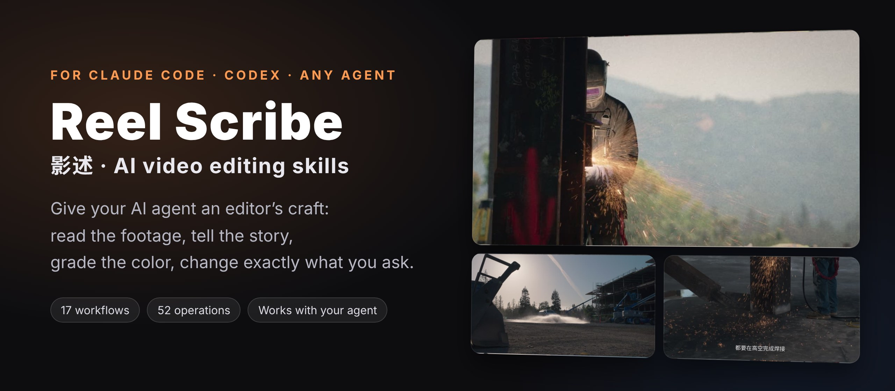
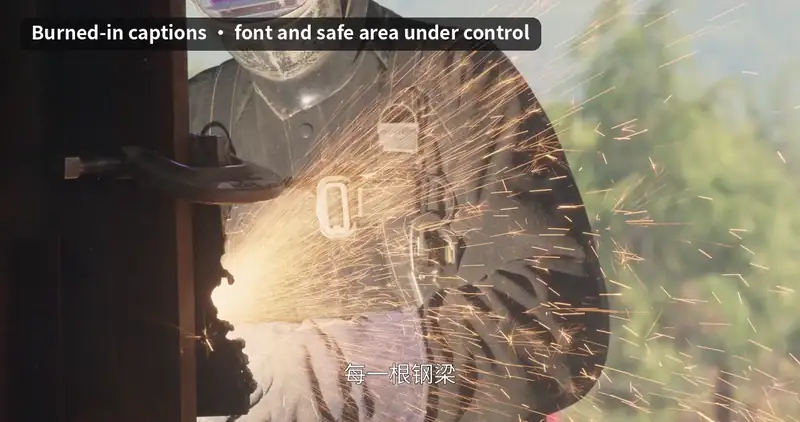
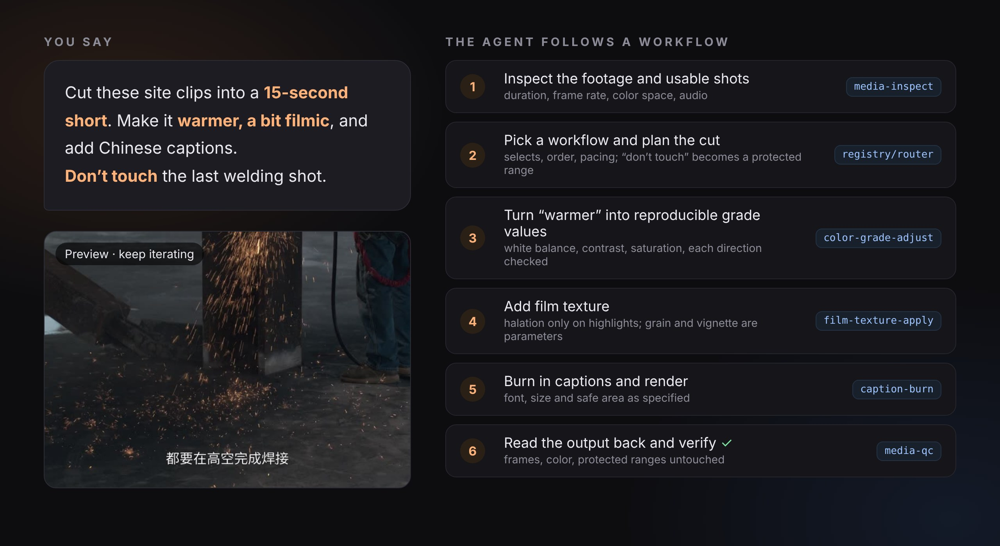
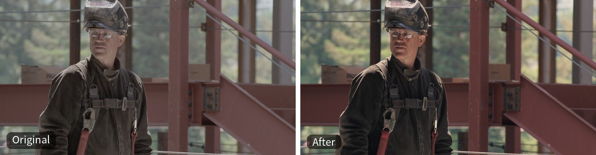
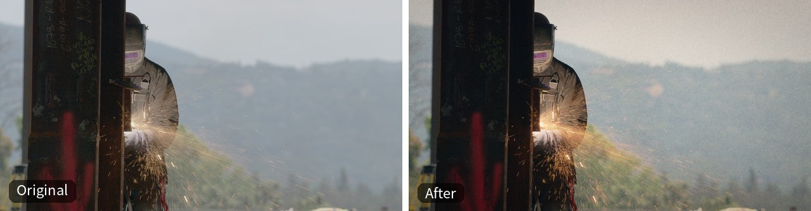
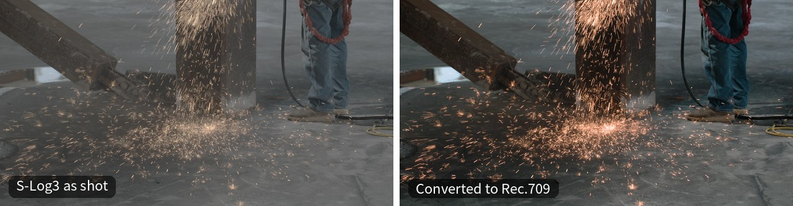
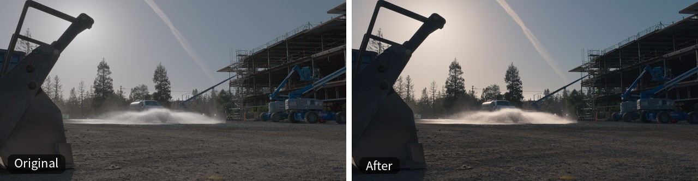
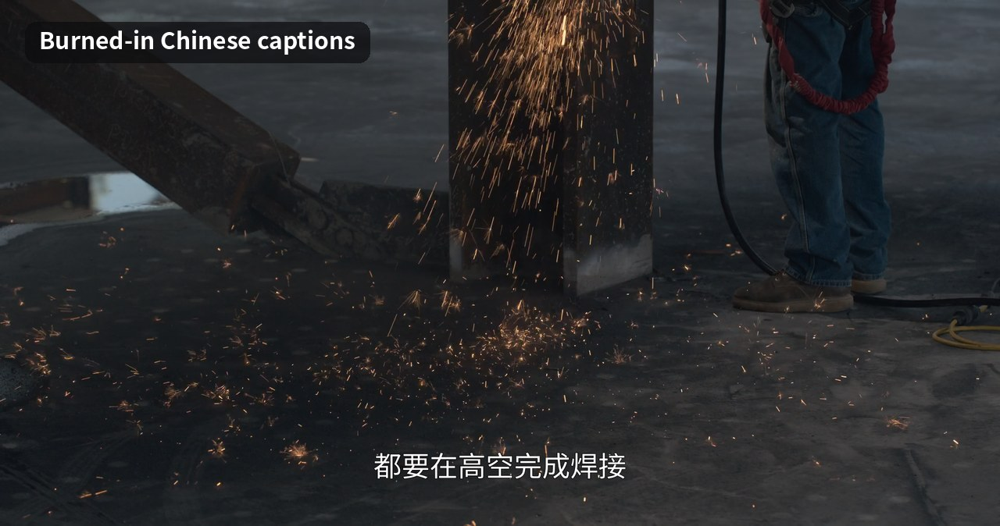
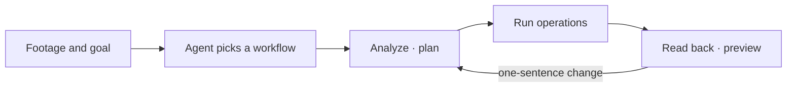

<div align="center">



### Let your AI agent edit video like an editor

Read the footage · plan the cut · grade, caption and mix step by step · change exactly what you ask, in plain words

[](https://github.com/dengxianghua888-ops/reel-scribe/stargazers)
[](docs/local-setup.md)
[](docs/local-setup.md)
[](https://m8ven.ai/mcp/dengxianghua888-ops-douyin-film-recap-vpiziq?s=readme)

[简体中文](README.md) · **English**

[Quick start](#-quick-start) · [Showcase](#-showcase) · [Workflows](#-editing-scenarios) · [Capabilities](#-capabilities) · [Film recaps](workflows/raven-film-recap/SKILL.md)



▶ [Watch the HD demo](https://github.com/dengxianghua888-ops/reel-scribe/blob/main/docs/assets/readme/en/showcase.mp4) · every effect in it was made by the library's own operations

</div>

## ✨ Why Reel Scribe

**Reel Scribe (影述)** is a video editing skill library for AI agents. It turns an editor's know-how into workflows and operations an agent can run: cut talking-head videos, make film recaps, shape interviews, grade and caption. Hand it over in one sentence.

- 🎬 **Editing judgment, not just filters**
  - 17 scenario workflows encode the decisions themselves: keep the argument and the pauses in a talk, protect the reveal order in a thriller recap, let viewers keep up with a tutorial.
  - The agent understands the footage and proposes a plan before it touches anything.
- 🗣️ **Revise the way you talk**
  - "Warmer", "a bit more contrast", "keep this caption", "don't touch the last shot" become reproducible parameters and explicit edit scopes.
  - Change one thing without disturbing the parts you already like.
- ✅ **Every step can be checked**
  - Every run leaves a receipt. Grading, Log conversion, film texture and Work renders also read the output back and check frames, color and protected ranges.
  - Every version is recorded, so you can always step back.
- 🔌 **Your agent, your tools**
  - Works with Claude Code, Codex and any agent that can read local files.
  - Plug in your own MCP servers, CLIs or editors, or use the bundled local executor (FFmpeg + Python).

## 🎬 Say it once, the agent gets to work



Describe what you want and what must not change. The agent picks the matching workflow: it inspects the footage, plans the cut, calls the operations one by one and reads the result back. If you only want the plan first, stop at the analysis.

## 🎨 Showcase

### Grade by sentence



Phrases like "warmer", "a bit more contrast" and "richer color" map through a fixed table to white balance, curves and saturation, and each direction is checked.

- Grade layers stack and can be undone one at a time.
- Exposure, white balance, ASC CDL, curves, HSL, highlight roll-off and LUTs are supported.
- Style cards carry parameter templates and limits, so a grade can't run away.

### Film texture



Halation appears only on highlights (watch the glow around the sparks), grain is seeded and reproducible, and the vignette can be switched on and off on its own. All three can live in a Work and render together with the grade.

### Camera Log, back to normal



Flat Log footage converts straight to a standard picture. Supported camera curves include Apple Log, S-Log3, V-Log, ARRI LogC3/LogC4, Canon Log and D-Log.

- Convert through a pinned OpenColorIO config or the camera maker's official LUT.
- ARRI's official LUT applied to an AMIRA clip matches the camera's own Rec.709 output (median ΔE2000 about 0.5).
- Phone HDR (HLG/PQ) converts to SDR too.

### One look across every shot



Apply one grade layer to every shot in a Work. You can also:

- fit editable grade values to a reference image;
- check that skin, sky and other protected areas stay consistent between shots, and stop the render if they don't.

### Chinese captions



Font, size, color, margins and safe area follow the parameters, and the font file is bound by hash. Caption timing can come from transcription, alignment or a script. Revising a caption changes only that line.

## 🧭 Editing scenarios

| You want to | The agent pays special attention to | Entry |
|---|---|---|
| Cut talks and explainers | Removing slips and repeats while keeping the argument, meaning and natural pauses | [Speech edit](workflows/raven-speech-edit/SKILL.md) |
| Recap a film or series | Characters and causality, reveal order, key scenes, narration vs. original sound | [Film recap](workflows/raven-film-recap/SKILL.md) |
| Write or revise short dramas | Character goals, state across scenes, storyboards, targeted fixes | [Drama production](workflows/raven-drama-production/SKILL.md) |
| Make tutorials and courses | Steps, screen focus, caption readability and pacing | [Software tutorial](workflows/raven-software-tutorial/SKILL.md) · [Course and meeting](workflows/raven-course-meeting/SKILL.md) |
| Edit interviews and multicam | Question and answer, speakers, camera sync and reaction shots | [Interview and multicam](workflows/raven-interview-multicam/SKILL.md) |
| Cut vlogs, events, documentaries | Turning loose footage into events, journeys and emotional arcs | [Vlog](workflows/raven-vlog-journey/SKILL.md) · [Event highlights](workflows/raven-event-highlights/SKILL.md) · [Documentary](workflows/raven-documentary-story/SKILL.md) |
| Revise a finished cut, make versions | Changing only the named captions, audio or picture; pacing and aspect ratio | [Local revision](workflows/raven-local-revision/SKILL.md) · [Pacing](workflows/raven-pacing-restructure/SKILL.md) · [Multi-platform](workflows/raven-multiplatform-batch/SKILL.md) |

Also: [commerce stories](workflows/raven-commerce-story/SKILL.md), [music montages](workflows/raven-music-montage/SKILL.md), [reference style](workflows/raven-reference-style/SKILL.md), [script-driven production](workflows/raven-script-generation/SKILL.md) and [localization](workflows/raven-localization/SKILL.md).

## 🧰 Capabilities

Under the workflows sit 52 operations that can also be called on their own. The agent combines them as needed:

| Area | What it covers |
|---|---|
| Understanding footage | Media inspection, local speech transcription, transcript import and comparison, signal scans, multicam sync |
| Editing and timelines | Timeline patches, revisions and renders, multicam plans, reframing, screen focus |
| Captions | Caption maps, burn-in, coverage checks, reading time and layout checks |
| Audio | Extraction, mixing, volume envelopes, voice synthesis |
| Color | Color measurement, grade compile and sentence adjustments, reference fitting, consistency checks, LUTs, HDR and Log input, film texture |
| Works and revisions | Versions, local undo, revision impact, variants and batch renders, style recipe previews |
| Editor bridges | Blender cut import and readback, Color Balance round trips |

See [atomic/](atomic/) for the full list and [registry/router.md](registry/router.md) for task routing. Most docs are in Chinese.

## 🚀 Quick start

**1. Get the library**

```bash
git clone https://github.com/dengxianghua888-ops/reel-scribe.git
cd reel-scribe
```

**2. Point your agent at the entry, then just describe the task**

Open the repo in Claude Code, Codex or another agent that can read local files:

```text
Read skills/editing-skill-library/SKILL.md first and pick the right workflow.

I have a talking-head video with subtitles and want a three-minute explainer.
List the segments you'd keep, cut or adjust, with reasons.
Keep complete arguments and natural pauses. Give me the edit plan first.
```

Reading the skills needs no API key; your agent decides which model and tools to use.

**3. When you want rendered output, turn on the local executor**

```bash
python3 scripts/install_doctor.py --root "$PWD"   # checks FFmpeg, numpy and friends
```

- The local MCP server exposes three tools, `list_skills`, `diagnose_installation` and `run_operation`; see the [local setup guide](docs/local-setup.md).
- For film recaps, use the [film recap pipeline](workflows/raven-film-recap/douyin-film-recap/README.md) with storyboards, captions, rendering and QC.

## 🏗️ How it works



| Folder | Contents |
|---|---|
| [workflows/](workflows/) | Editing workflows by scenario |
| [atomic/](atomic/) | Operations for media, captions, audio, color and timelines |
| [styles/](styles/) | Narrative, pacing, sound and visual style cards |
| [contracts/](contracts/) | Inputs, outputs, edit scopes and handoff protocols |
| [runtime/](runtime/) | The local executor |
| [registry/](registry/) | Skill index and task routing |

## 🤝 Contributing and license

- Share your editing needs, integration experience or problems in [Issues](https://github.com/dengxianghua888-ops/reel-scribe/issues). If it helps you, a ⭐ star is appreciated; use Watch → Releases to follow new versions.
- More docs (Chinese): [development status](docs/development-status.md) · [local setup](docs/local-setup.md) · [releases](https://github.com/dengxianghua888-ops/reel-scribe/releases) · [migration](docs/migration-v0.3.md)
- License: the film recap production subset is MIT; the general library and some reference material have their own terms. Read the [license and sources notes](LICENSES.md) before commercial use or redistribution.
- The demo footage is made from Netflix's *Sparks* (CC BY 4.0); see the [attribution and changes](provenance/distribution-notices/readme-demo-media-NOTICE.md).
