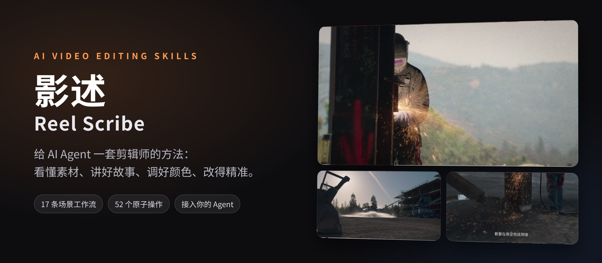
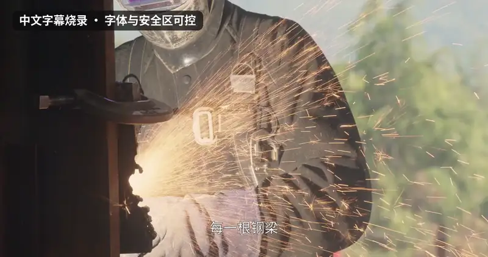
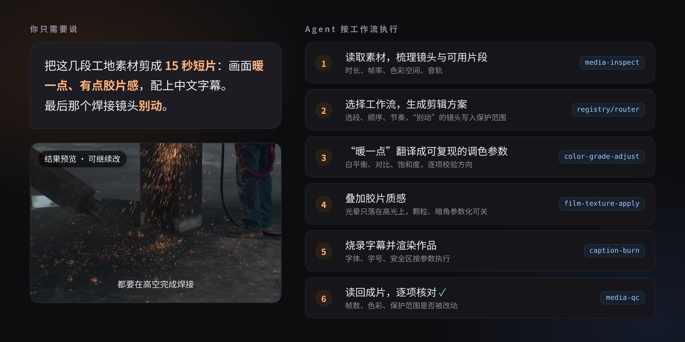
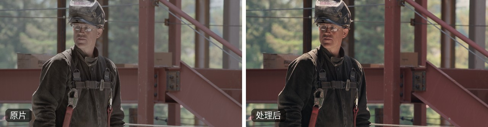
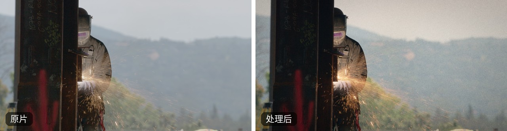
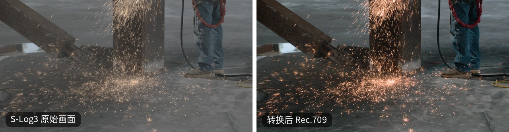
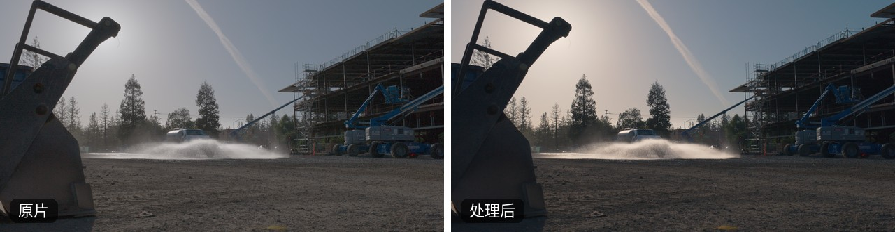
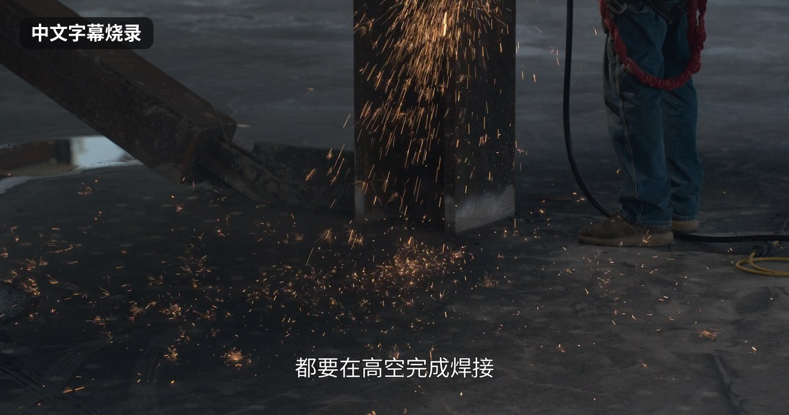
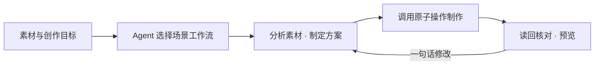

<div align="center">



### 让 AI Agent 像剪辑师一样剪视频

看懂素材 · 写出剪辑方案 · 调色、字幕、声音一步步做出来 · 说一句话就能精准地改

[](https://github.com/dengxianghua888-ops/reel-scribe/stargazers)
[](docs/local-setup.md)
[](docs/local-setup.md)
[](https://m8ven.ai/mcp/dengxianghua888-ops-douyin-film-recap-vpiziq?s=readme)

[快速开始](#-快速开始) · [效果展示](#-效果展示) · [场景工作流](#-覆盖的剪辑场景) · [能力一览](#-能力一览) · [影视解说](workflows/raven-film-recap/SKILL.md)



▶ [观看高清演示视频](https://github.com/dengxianghua888-ops/reel-scribe/blob/main/docs/assets/readme/showcase.mp4) · 片中每个效果都由本库的原子操作生成

</div>

## ✨ 为什么是影述

**影述（Reel Scribe）** 是一套给 AI Agent 用的视频剪辑技能库。它把剪辑师的经验整理成 Agent 能直接执行的工作流和操作：剪口播、做影视解说、整理访谈、调色加字幕，一句话就能交给 Agent。

- 🎬 **懂剪辑，不只是套滤镜**
  - 17 条场景工作流，写的是剪辑判断本身：口播要保住观点和停顿，悬疑解说要守住揭示顺序，教程要让观众跟得上操作。
  - Agent 先理解素材、给出方案，再动手。
- 🗣️ **用说话的方式改片子**
  - “暖一点”“对比强一点”“这句字幕别动”“最后那个镜头别碰”，都会变成可复现的参数和明确的修改范围。
  - 改一处，不会动到你满意的部分。
- ✅ **每一步都能核对**
  - 每次执行都会留下回执。调色、Log 转换、胶片质感和作品渲染完成后，还会读回成片，核对帧数、色彩和保护范围。
  - 每个版本都有记录，随时可以回到上一版。
- 🔌 **用你自己的 Agent 和工具**
  - Claude Code、Codex 等能读取本地文件的 Agent 都可以直接使用。
  - 剪辑工具可以接你已有的 MCP、CLI 或编辑器，也可以用库里自带的本地执行器（FFmpeg + Python）。

## 🎬 说一句话，Agent 就开始干活



你描述想要的效果和不能动的地方，Agent 选择对应的场景工作流：先读素材、出方案，再逐步调用原子操作完成制作，最后读回成片核对。想先看方案再决定，也可以只停在分析这一步。

## 🎨 效果展示

### 一句话调色



“更暖”“对比强一点”“颜色浓一点”这类说法，会按固定的映射表换成白平衡、曲线和饱和度参数，并逐项校验方向对不对。

- 调色层可以叠加，也可以单独撤回。
- 支持曝光、白平衡、ASC CDL、曲线、HSL、高光滚降和 LUT。
- 风格卡附带参数模板和上限，避免把画面调坏。

### 胶片质感



光晕只出现在高光处（看焊接火花周围的辉光），颗粒带随机种子、可以复现，暗角可以单独开关。三种效果都可以写进作品，和调色一起渲染。

### 相机 Log 一键还原



灰蒙蒙的 Log 素材可以直接转成标准画面，支持 Apple Log、S-Log3、V-Log、ARRI LogC3/LogC4、Canon Log、D-Log 等相机曲线。

- 转换可以用固定版本的 OpenColorIO 配置，也可以用厂商官方 LUT。
- 用 ARRI 官方 LUT 转换 AMIRA 原片，结果与相机自己输出的 Rec.709 几乎一致（中位 ΔE2000 约 0.5）。
- 手机 HDR（HLG/PQ）也能转成 SDR。

### 整片统一影调



同一个调色层可以套到整部作品的所有镜头上。还可以：

- 拿一张参考图，自动拟合出可编辑的调色参数；
- 检查肤色、天空等保护区域在镜头之间是否一致，不达标就不出片。

### 中文字幕



字体、字号、颜色、边距和安全区都按参数执行，字体文件按哈希绑定。字幕时间可以来自转写、对齐或剧本。改字幕时只动指定的那一行。

## 🧭 覆盖的剪辑场景

| 你想做的 | Agent 会特别注意 | 入口 |
|---|---|---|
| 剪口播、知识分享 | 去掉口误和重复，保住观点、语义和自然停顿 | [口播剪辑](workflows/raven-speech-edit/SKILL.md) |
| 电影、剧集解说 | 人物和因果、揭示顺序、名场面，旁白和原声怎么分工 | [影视解说](workflows/raven-film-recap/SKILL.md) |
| 原创短剧、漫剧 | 人物目标、跨场状态、分镜，以及局部返修 | [剧情创作与制作](workflows/raven-drama-production/SKILL.md) |
| 软件教程、课程 | 操作步骤、画面焦点、字幕可读性和讲解节奏 | [软件教程](workflows/raven-software-tutorial/SKILL.md) · [课程与会议](workflows/raven-course-meeting/SKILL.md) |
| 访谈、多机位 | 问答关系、说话人、机位同步和反应镜头 | [访谈与多机位](workflows/raven-interview-multicam/SKILL.md) |
| Vlog、活动、纪录 | 从零散素材里理出事件、人物经历和情绪变化 | [Vlog](workflows/raven-vlog-journey/SKILL.md) · [活动高光](workflows/raven-event-highlights/SKILL.md) · [纪录叙事](workflows/raven-documentary-story/SKILL.md) |
| 改成片、出多版本 | 只改指定的字幕、声音或画面，调节奏、换画幅 | [局部修改](workflows/raven-local-revision/SKILL.md) · [节奏调整](workflows/raven-pacing-restructure/SKILL.md) · [多平台版本](workflows/raven-multiplatform-batch/SKILL.md) |

还有[商品叙事](workflows/raven-commerce-story/SKILL.md)、[音乐混剪](workflows/raven-music-montage/SKILL.md)、[参考风格](workflows/raven-reference-style/SKILL.md)、[脚本驱动制作](workflows/raven-script-generation/SKILL.md)和[本地化](workflows/raven-localization/SKILL.md)。

## 🧰 能力一览

工作流底下是 52 个可以单独调用的原子操作，Agent 按需组合：

| 类别 | 能做什么 |
|---|---|
| 素材理解 | 媒体检查、本地语音转写、转写导入与比对、画面信号扫描、多机位同步测量 |
| 剪辑与时间线 | 时间线补丁、修订与渲染、多机位方案、画幅重构、屏幕焦点 |
| 字幕 | 字幕映射、烧录、覆盖率检查、阅读时长与排版检查 |
| 声音 | 音频提取、混音、音量包络、配音合成 |
| 调色 | 色彩测量、调色编译与一句话调整、参考图拟合、一致性检查、LUT 套用、HDR 与 Log 输入转换、胶片质感 |
| 作品与修改 | 作品版本、局部撤销、修改影响分析、变体与批量渲染、风格配方预览 |
| 编辑器桥接 | Blender 剪切导入与读回、Color Balance 调色互通 |

完整列表见 [atomic/](atomic/)，任务路由见 [registry/router.md](registry/router.md)。

## 🚀 快速开始

**1. 获取技能库**

```bash
git clone https://github.com/dengxianghua888-ops/reel-scribe.git
cd reel-scribe
```

**2. 让 Agent 读取入口，然后直接说任务**

在 Claude Code、Codex 等能读取本地文件的 Agent 里打开仓库：

```text
请先读取 skills/editing-skill-library/SKILL.md，选择合适的工作流。

我有一段口播视频和字幕，想剪成三分钟左右的知识分享。
先列出建议保留、删除和调整的片段，说明理由；
保留完整观点和自然停顿，先给我剪辑方案。
```

只读取 Skill 不需要任何 API Key，模型和工具由你的 Agent 决定。

**3. 需要实际出片时，打开本地执行器**

```bash
python3 scripts/install_doctor.py --root "$PWD"   # 检查 FFmpeg、numpy 等依赖
```

- 本地 MCP 服务提供 `list_skills`、`diagnose_installation` 和 `run_operation` 三个工具，配置见 [本地接入说明](docs/local-setup.md)。
- 做影视解说可以直接用 [影视解说流水线](workflows/raven-film-recap/douyin-film-recap/README.md)，包含 Storyboard、字幕、渲染和质检。

## 🏗️ 工作原理



| 目录 | 内容 |
|---|---|
| [workflows/](workflows/) | 按场景组织的剪辑工作流 |
| [atomic/](atomic/) | 素材、字幕、声音、调色、时间线等原子操作 |
| [styles/](styles/) | 叙事、节奏、声音与视觉风格卡 |
| [contracts/](contracts/) | 输入输出、修改范围与作品交接协议 |
| [runtime/](runtime/) | 本地执行器 |
| [registry/](registry/) | Skill 索引与任务路由 |

## 🤝 参与与许可

- 欢迎在 [Issues](https://github.com/dengxianghua888-ops/reel-scribe/issues) 分享你的剪辑需求、适配经验或问题。觉得有用，点个 ⭐ Star 支持一下；想关注新版本，用 Watch → Releases 订阅。
- 更多文档：[开发状态](docs/development-status.md) · [本地接入](docs/local-setup.md) · [版本发布](https://github.com/dengxianghua888-ops/reel-scribe/releases) · [从旧版迁移](docs/migration-v0.3.md)
- 许可：影视解说制作子集使用 MIT；通用库及部分参考材料另有使用条件，商用或再分发前请看[许可与来源说明](LICENSES.md)。
- 首页演示画面基于 Netflix《Sparks》（CC BY 4.0）制作，[署名与改动说明](provenance/distribution-notices/readme-demo-media-NOTICE.md)。
