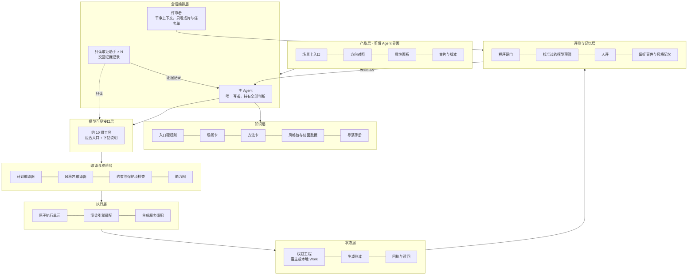

# 02 顶层架构：剪辑 Agent 的八层结构与十条不变量

本章定义 v2 的整体结构。它在多风格方案[00 顶层设计](../multi-style/00-top-level.md)的分层上增加两层，并为每一层写明谁持有、模型能否直接看到、对应哪些现有资产。

## 一、八层结构

| 层 | 职责 | 持有者 | 模型直接可见 | 对应现有资产 |
| --- | --- | --- | --- | --- |
| L1 产品层 | 让用户用卡片指定场景、在对照中选方向、只改一处属性、审片与撤回 | 剪辑 Agent | — | 研究库 ChatCut 卡片研究、多风格方案 I8/I10 |
| L2 会话编排层 | 主 Agent 解析任务单、做全部需要一起权衡的判断、唯一调用写入组；取证助手并行只读；评审者独立看成片 | 宿主运行时 | — | 现有入口 Skill 与运行 Agent；取证与评审为新增 |
| L3 知识层 | 告诉模型“怎么判断”：硬规则、场景卡、方法卡、风格包数据、导演手册 | 影述、精品短剧 Skill | 部分（硬规则常驻，其余按需） | `router.md`、17 条工作流、580 张风格卡、多风格目录 |
| L4 模型可见接口层 | 约 10 组带类型的工具，每组 4–10 个操作，另有说明与下钻入口 | 影述（MCP 或宿主原生） | 是 | 现为 `run_operation` 单入口；新增 |
| L5 编译与校验层 | 把模型给出的意图编译成候选；检查保护项、锁轨、时长、依赖；不可满足时给出冲突项和可放宽项 | 影述 runtime 或宿主 | 否 | 8 个 `*-plan-compile`、`style-recipe-compile`、规划中的 `style-pack-compile` |
| L6 执行层 | 原子执行单元、渲染引擎、生成服务适配 | 影述 runtime 或宿主 | 否 | 51 个原子；规划中的 19 个新原子 |
| L7 状态层 | 权威工程、生成账本、回执与读回 | 宿主（阶段 B、C）或本地 Work（阶段 A） | 只读视图 | Work 合同、`generation-task` 合同 |
| L8 评测与记忆层 | 程序硬门、模型预筛、人评、偏好事件、风格记忆 | 影述与宿主共建 | 否 | `media-qc`、色彩门禁、多风格方案 09/12 章 |

与多风格方案相比，新增的是 L4 与 L2 中的取证助手、评审者。L4 把“模型要做几次正确操作”变成可以设计、可以测量的对象；取证助手把可以独立核对的工作从主上下文里拿出去。

## 二、十条不变量

这些规则在任何 harness 下都成立。它们写进合同和代码，不只写在提示词里。

| 编号 | 不变量 | 为什么 | 由谁保证 |
| --- | --- | --- | --- |
| V1 | **一支笔。** 只有主 Agent 能调用写入组；取证助手和评审者的工具白名单只含读取组 | 动作隐含决定，多个写者会产生互相冲突的修改；重启的代理已改的文件会保留 | harness 的工具权限 |
| V2 | **写入只走“意图 → 编译 → 候选 → 预览 → 提交”。** 没有绕过编译器的写入捷径 | 校验器管得住结构；Cassette-Editor 类结果显示损失集中在规则边界与复合编辑† | L4 只暴露意图类操作 |
| V3 | **每次写入带基准版本和修改编号。** 同一编号重放返回同一回执；版本不符拒绝并要求重读 | 防覆盖、防重复生效 | L5/L7 |
| V4 | **读回三级。** 每次写入后读回实际差异，结果为 `verified`、`unverified` 或 `contradiction`；后两者不得报告“完成” | 工具报成功不等于工程真的变了（Resolve 实例） | L7 |
| V5 | **证据交接用证据记录，不用自然语言摘要代替。** | 摘要丢掉决定剪法的细节，主创无法回原片核验 | L2 与 `evidence-record/1` |
| V6 | **需要一起权衡的判断留在主上下文。** 取哪一段、节奏与强度分配、是否交付，不交给各自为战的助手 | 顺序依赖任务被拆分时表现大幅下降；付费试拍中“按用途取段”贡献了 45.8% 的成片帧 | 场景卡写明哪些判断不可外包 |
| V7 | **知识不能放宽保护项。** 保护项检查在编译器里执行 | 提示词里的规则会被遗漏或覆盖 | L5 |
| V8 | **生成任务有独立账本。** 回片先进素材池，经候选与提交才进时间线 | 生成状态与编辑状态各有生命周期；重复提交会直接花钱 | L7 生成账本 |
| V9 | **新资产先过测量阶梯才进路由池。** 场景卡、方法卡、风格包、组件、原子都适用 | 技能负迁移并不罕见；未验证的资产是负债 | L3 状态字段与路由池过滤 |
| V10 | **每个任务记录成本分母。** token、调用数、时长、积分、人工介入时间 | 没有分母就做不了同预算比较 | L8 遥测 |

## 三、核心对象与数据契约

沿用多风格方案已定义的 `material-profile/1`、`style-route-result/1`、`style-plan/1`、`work-candidate/1`、`drama-post-handoff/1`、`shot-request/1`、`generation-return/1`。新增或扩展以下五个。

### 1. `task-spec/1`：一次解析代替三级路由

把多风格方案的场景路由、生产路线、风格意图合并成一份任务单。主 Agent 在开始任何读写前填好它，用户可以在界面上看到并改。

| 字段 | 内容 | 来源 |
| --- | --- | --- |
| `delivery_mode` | 分析、方案、可编辑计划、成片、修订 | 原话、上下文或推断，逐项标来源 |
| `scenario` | 场景卡 ID，或 `adhoc` | 界面卡片（指定）或检索（自选） |
| `production_route` | `EDIT / GENERATE / HYBRID / PLAN` 与返工单位 | 素材起点 |
| `frozen` / `negations` | 冻结与否定约束，如“音乐和前面都别动” | 原话优先 |
| `style_intent` | 风格说法记成的约束 | 原话 |
| `budget` | token、时长、积分上限；没设时按分批规则执行 | 用户或项目默认 |
| `state_authority` | `local-work`（兼容模式）或 `host:<项目 ID>`（接入模式），任务进行中不切换 | 连接状态与任务指向，见 [04](04-harness.md) §二 |
| `missing` | 缺项与要问用户的问题 | 解析结果 |

### 2. `evidence-record/1`：取证助手交回什么

| 字段 | 内容 |
| --- | --- |
| `asset` | 素材指纹、版本、可访问路径 |
| `range` | 源时基下的起止帧，以及成片位置（如已在时间线上） |
| `observation` | 看到或听到的事实，如“先看对方，吸气，低头；原声有门响” |
| `playback_ref` | 可回放的代理片段或截帧联系表 |
| `confidence` 与 `uncertain` | 置信度与不确定之处 |
| `considered_but_rejected` | 看过但没选的片段及原因 |
| `method` | 用了哪些读取工具、抽帧间隔、是否听了音频、模型身份 |

`considered_but_rejected` 是事后排查“漏找”的唯一线索；`method` 记录评审条件，避免“没听声音”的判断被当成完整判断。

### 3. `edit-intent/1`：模型写入的唯一形态

模型不再拼完整的 WorkDocument，而是给出带类型的意图。编译器把意图展开成候选，补齐哈希、版本、连带变更与保护项检查。

| 操作 | 关键参数 | 编译器负责 |
| --- | --- | --- |
| `replace_same_length` | 目标片段、候选源区间、音轨策略 | 保持时长、锁轨检查、连带变更 |
| `trim_words` / `restore_words` | 词 ID 区间、保护词 | 调用 `speech-plan-compile`，重算源映射 |
| `reorder` / `insert` / `remove` | 片段或段落、位置 | 依赖检查、受影响项列表 |
| `set_component_props` | 实例 ID、已声明属性、新值 | 类型与范围校验，只改该实例 |
| `apply_style_plan` | 风格计划 ID | 调用 `style-pack-compile` |
| `regrade_layer` / `mix_audio` | 调色层或音轨、参数 | 调用色彩与音频编译 |
| `adopt_generation` | 生成候选、源区间、目标位置 | 经候选采用，不直接覆盖 |

每个意图都带 `base_version` 与 `edit_id`。编译失败时返回结构化原因：哪条约束冲突、哪些参数可以放宽。

### 4. `write-receipt/1`：每次写入留下什么

| 字段 | 内容 |
| --- | --- |
| `edit_id`、`base_version`、`new_version` | 修改编号与前后版本 |
| `intent_digest` | 意图摘要；同编号重放时比对，意图不同则拒绝 |
| `actual_diff` | 读回的实际变更：轨道、区间、实例、属性 |
| `readback` | `verified`、`unverified`、`contradiction`，以及读回方式 |
| `checks` | 保护项、锁轨、时长、响度等检查结果 |
| `cost` | 本次调用的耗时与资源 |

现有 Work commit 已有版本令牌比对；本仓库 `generation-task` 已有“同键不同意图拒绝”的幂等键。v2 把两者合在一起，推广到所有写入。

### 5. `preference-event/1` 与 `review-record/1`

沿用多风格方案 12 章 R3 的设计。阶段 1 起记录：盲评选择、方向选择、采用与撤回、用户手改。只记录特征与哈希，不存素材；须明确同意（已定）。

## 四、任务单的解析顺序

1. **常驻硬规则先行。** 入口只常驻十几条必须时时遵守的规则：冻结与否定约束优先进任务单；先定交付形式；仅分析不启动渲染与生成；参数齐全的明确字段直接走对应工具组；缺关键对象时先问。
2. **界面已指定场景时直接用。** 在剪辑 Agent 里，用户点了场景卡，就等于“指定组”，不再做语义路由。
3. **否则检索召回。** 对场景卡与方法卡的全文做检索，召回 3–7 个候选，模型只读命中部分。
4. **加载门控。** 模型先判断“这些候选是否需要加载”。不需要时不加载，避免过度执行看似相关的方法。
5. **写出任务单并让用户可见。** 缺项列在 `missing`，按需追问。

## 五、三条请求的完整走法

### A. 局部修订：“把最后那个拥抱换掉，音乐和前面都别动”

| 步骤 | 谁决定 | 调用 | 产物 |
| --- | --- | --- | --- |
| 解析 | 主 Agent | 无 | 任务单：修订、冻结音乐与前段、意图“认出对方” |
| 读工程 | 主 Agent | `work.read(scope)` | 当前版本、末镜头边界、锁定轨道 |
| 取证 | 2–3 位只读助手并行 | `media.*`、`evidence.search` | 各自的证据记录，含看过没选的片段 |
| 选择 | 主 Agent | 无（读证据记录，必要时回看原片） | 两个候选 |
| 试两版 | 主 Agent | `edit.propose(replace_same_length)` × 2 | 两个候选版本与差异 |
| 预览对照 | 主 Agent | `render.preview_pair` | 与原版同点试听的对照 |
| 采用 | 用户或主 Agent | `edit.commit` | 回执，读回为 `verified` 才算完成 |

主 Agent 的写入相关调用从现在的 5–6 次严格 JSON（读取、合成完整候选文档、修订、预览、提交、渲染）降到 3–4 次带类型的意图，哈希与版本由程序持有。

### B. 口播风格化：“这条测评出三个不同风格”

| 步骤 | 谁决定 | 调用 |
| --- | --- | --- |
| 画像 | 只读助手按章节并行；主 Agent 汇总 | `media.profile`（内部调用 `content-signal-extract`、`subject-safe-zone-detect`、`material-profile-build`） |
| 路由 | 程序打分，主 Agent 可推翻并写理由 | `style.route` |
| 预览 | 程序 | `style.preview`（文字方案、风格帧、样段） |
| 选择 | 用户 | 界面方向对照 |
| 编译 | 主 Agent 给出方法刻面的语义选择，编译器完成其余 | `edit.propose(apply_style_plan)` |
| 检查与采用 | 程序硬门，用户采用 | `render.preview` → `review.check` → `edit.commit` |

### C. 短剧补镜：剪辑中发现缺一个反应镜头

| 步骤 | 谁决定 | 调用 |
| --- | --- | --- |
| 发现缺口 | 剪辑侧主 Agent | 写 `shot-request/1`：位置、时长、观众此刻要知道什么、前后镜状态帧 |
| 导演 | 精品短剧 Skill（导演上下文） | 按风格圣经编写镜头单 |
| 发单前检查 | 程序 | `gen.preflight`：参考图与运动参考是否矛盾、预算、合规 |
| 分批生成 | 主 Agent | `gen.submit`（先两条）→ `gen.status`，回片复核前不提交下一批 |
| 候选检查 | 只读助手逐条扫缺陷（手指、道具、首帧衔接、口型） | `media.*`，交回证据记录 |
| 按用途取段 | 导演 | 读证据记录与回片，选取哪一段 |
| 采用 | 剪辑侧主 Agent | `edit.propose(adopt_generation)` → `edit.commit` |

## 六、与研究库 I0–I12 接口的对应

| 工具组 | 对应接口 | 说明 |
| --- | --- | --- |
| `work.*` | I0 读取、I1 编辑会话（提交、放弃、读回、撤回） | 宿主实现时沿用研究库任务卡的边界用例 |
| `transcript.*` | I2 词稿读回与锚点 | 稳定词 ID 与出现 ID |
| `render.*` | I3 同点试听 | 原版与候选成对结果 |
| `edit.*` | I1 预演、I4 词级预演与计划翻译、I5 实例属性 | 意图编译后进入宿主编辑会话 |
| `evidence.*` | I6 工程证据绑定 | 主张—证据表 |
| `style.*` | I8 卡片与风格注册、I9 组件渲染适配、I10 多风格变体 | 风格包编译后经 `edit.*` 写入 |
| `gen.*` | I11 生成任务 | 账本、分批、采用门 |
| `review.*` | I12 评测 harness | 硬门、预筛、盲评任务 |
