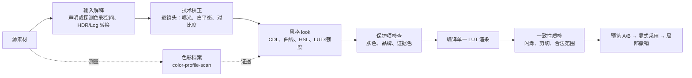

# 色彩与调色层：调研与迭代规划（2026-11-19）

基线：`main@35628f1`。本页是**规划**，不是实现或验收记录。文中“已核实”指读过一手页面或仓库元数据；
“检索摘要”指只看到搜索引擎摘要、未读全文（本环境无法访问 arXiv 全文），引用前需复核。

## 0. 一页结论

**现状。** 本库在调色方面只有一个可执行原子 `color-lut-apply`。它只支持 BT.709 SDR、8 位、零起点恒定帧率，
不能调强度，也不能匹配参考。

调色知识集中在约 8 张风格卡里，都是定性描述，没有参数，状态是“效果未验证”。另外三点：
- 测量只有亮度和帧差。
- Work 文档没有色彩字段，风格配方的“预览 → 采用 → 撤销”闭环只覆盖字幕和音频。
- 影视流水线不处理手机 HLG、HDR 或 Log 素材。

**业界方向。** 最新的 Agent 式调色系统（LumiVideo，2026）走的是：
- 流程：“感知 → 推理 → 执行 → 反思”，与本库“Agent 判断、原子执行、证据读回、预览采用”的架构几乎同构。
- 输出：把决策编译成**可编辑的参数（ASC-CDL）加一个统一的 3D LUT**，而不是直接改像素。

剪映、CapCut 和 Adobe 的产品形态说明，用户期待四件事：
- 一键或参考匹配；
- 一个强度滑杆；
- 少量直观参数（色温、色调、光感、HSL、曲线）；
- 对肤色、天空等局部的保护。

**建议。** 把色彩做成 Work 里的一等图层，称为 Color Layer。
- **分层**：“输入解释 → 技术校正 → 风格 look → 保护项”四层分开。
- **表示**：参数化，编译成单一 LUT 渲染，同时可导出 CDL、CLF 或 cube。
- **测量**：新增色彩特征测量原子，让参考迁移有可量化的证据。
- **复用**：直接接入现有的风格配方、预览、比较交换（CAS）采用和局部撤销，不另起一套状态。

**路线。** 分五个阶段 C0–C4，每阶段把技术验证、效果验证和人工验收分开记录。C0–C2 不引入任何新的必需依赖。

## 1. 现状盘点

| 层 | 现有能力 | 主要缺口 |
|---|---|---|
| 执行 | [color-lut-apply](../atomic/color-lut-apply/SKILL.md)：3D cube（2–65 阶）、四面体或三线性插值、逐帧时钟与音频载荷校验、请求标签与探测标签分开记录 | 无强度、无参数化调色（曝光、白平衡、曲线、HSL）、无逐镜头或局部应用、不支持 HDR、Log、10 位 |
| 测量 | [media-signal-scan](../atomic/media-signal-scan/SKILL.md)：平均亮度、相邻帧差、音频 RMS | 无色度、色相、白平衡、调色板、剪切比例、肤色等色彩统计 |
| 风格知识 | reference 卡：克制色域、冷暖关系、高光柔和、暗部可读、有目的的单色、跨镜颜色连续；另有 music-montage 色彩线索、film-recap 感官氛围 | 只有定性描述和反例，没有参数模板、测量指标或适用阈值；均为“已设计，效果未独立验证” |
| 作品状态 | [Work](../contracts/work-contract.md)、[风格配方](../contracts/style-recipe-contract.md)、预览、局部撤销 | WorkDocument 无色彩字段；配方参数组只有 `caption_style`、`audio_gain_db`、`caption_overrides`、`audio_envelope` |
| 工作流 | [参考风格适配](../workflows/raven-reference-style/SKILL.md)的迁移矩阵已要求“参考证据 → 机制 → 操作 → 验收证据” | 色彩维度缺测量与执行原子，矩阵只能停在描述 |
| 影视子集 | 渲染合同记录 `color_primaries`、`color_transfer` 等元数据 | 没有 HDR → SDR 或 Log 输入转换，也没有调色；手机 HLG 素材的实际输出效果**未验证**（C0 要实测） |
| 宿主适配 | Blender 剪切导入与读回、字幕候选 | 未映射 Blender 片段的 Color Balance（同时支持 Lift/Gamma/Gain 和 ASC-CDL 两种模式） |
| 底座 | 本地 FFmpeg 6.1 具备 `lut1d/lut3d/haldclut`、`colorbalance`、`colortemperature`、`curves`、`huesaturation`、`selectivecolor`、`vibrance`、`exposure`、`zscale`、`tonemap`、`libplacebo`、`signalstats`、`vectorscope`、`deband` | 未使用；不同构建的滤镜可用性要进 `install_doctor` |

## 2. 调研发现

### 2.1 色彩风格用哪些维度描述

学术和产品里描述 look 的维度基本一致，可以分成三类。
- **可测量**：本库能先用确定性算法实现。
- **需区域**：必须由调用方声明区域，或另有检测器。
- **需人判断**：只能作为解释，不能自动下结论。

| 维度 | 可测量特征（候选） | 类别 | 备注 |
|---|---|---|---|
| 影调与对比 | 亮度分位数（p1/p5/p50/p95/p99）、黑白点、暗部抬升（褪色黑）、高光滚降斜率、剪切比例 | 可测量 | 剪映的“光感”接近按亮度分区的提亮或压暗 |
| 白平衡 | 灰世界或亮区中性估计、Lab 空间 a\*/b\* 均值、估算色温和色调偏移 | 可测量 | 剪映、CapCut 都把色温（蓝黄）和色调（绿品）分开 |
| 饱和度与鲜艳度 | 色度分布、分区饱和度、Hasler–Süsstrunk 鲜艳度 | 可测量 | — |
| 色相分布与分离色调 | 色相直方图，暗部和亮部各自的色偏（如青橙） | 可测量 | 对应风格卡“冷暖关系” |
| 调色板 | 主色与点缀色（下采样后在 Lab 空间做固定种子的 k-means）及占比 | 可测量 | 检索摘要显示，MegaStyle++ 把色彩风格拆成调色板、属性（饱和度、色温）、组合、分布四个层次（**未核实**） |
| 颜色组合与和谐 | 相邻色关系、和谐模板 | 需人判断 | 只作解释 |
| 肤色 | 示波器肤色线（约 123°）附近的色相与色度偏差 | 需区域 | 肤色线只是参考，风格化画面不必压到线上 |
| 质感 | 颗粒、光晕（halation）、柔光（bloom）、暗角 | 需人判断 | Dehancer、FilmConvert 都把这些做成独立可调参数 |
| 时间一致性 | 镜头内与镜头间统计量的漂移、闪烁 | 可测量 | 对应风格卡“跨镜颜色连续” |

### 2.2 参考匹配与风格迁移方法

| 类别 | 代表方法 | 对本库的价值 | 风险与许可 |
|---|---|---|---|
| 统计迁移 | Reinhard（Lab 均值与方差）、MVGD/MKL（Pitié）、直方图匹配、复合方法 HM-MVGD-HM | 简单、可解释，能烘焙成 LUT，适合作为第一版“参考匹配” | 现成库 `color-matcher` 是 **GPL-3.0**（已核实），不宜作依赖；按论文公式独立实现 |
| 参数拟合 | 把统计目标拟合为 CDL、曲线、HSL 参数 | 结果可编辑、可撤销、可导出；LumiVideo 也编译为 ASC-CDL 加 3D LUT | 需定义可解释的参数边界 |
| 学习型 LUT | 图像自适应 3D LUT（Zeng 2020）、NILUT（AAAI 2024，单网络融合多风格）、D-LUT（WACV 2025）、SA-LUT（4D，ICCV 2025） | 研究方向：风格混合、上下文自适应 | NILUT 代码 MIT，其 LUT 为 CC 4.0（具体条款未写明） |
| 视频 LUT 生成 | Video Color Grading via LUT Generation（ICCV 2025）：先提取调色风格，再用扩散模型生成 LUT | 参考图到视频的 LUT 生成 | 代码 Apache-2.0；**预训练权重和 LUT 基库在网盘，未声明条款**（已核实），不可随包分发 |
| 视频时间一致 | Bonneel 等 SIGGRAPH 2013：逐帧变换按曲率最小插值，选关键帧供手调 | 逐镜头调色与关键帧平滑的成熟思路 | 需要镜头分段输入（本库已有片段与证据单元） |
| Agent 式调色 | LumiVideo（arXiv 2604.02409）：LLM 加 RAG 和思维树搜索，编译为 CDL 加 LUT，自然语言反思；LLM 工具链编辑（arXiv 2410.02952）：全局调色、可选颜色、LUT 预设三类工具 | 架构几乎可直接映射：风格卡作为 RAG 语料，原子作为工具，预览作为反思 | LumiVideo 的效果结论被第三方评审认为缺少定量证据；其基准用无参考画质指标，**不能作为本库验收依据** |
| 2026 新作 | StatLUT、ColorFM、Hist2Style、Adaptive Color Grading | 方向参考 | 均为**检索摘要**，未核实 |

**结论：** 第一版参考匹配用“统计目标 → 拟合到可编辑参数 → 编译 LUT → 预览”。学习型方法放研究轨道，必须先解决权重和数据许可。

### 2.3 色彩管理与输入

- **ACES 与 OCIO**：
  - ACES 2.0 已于 2025 年发布。
  - OCIO 2.4.2 定稿了 ACES 2 输出变换；2.5（2025-09）内置 ACES 2.0 的 Studio 和 CG 配置。
  - OCIO 在 PyPI 有多平台预编译包，最新 2.6.0（2026-10-01），许可 BSD-3（已核实）。
  - OCIO v2 完整支持 Academy/ASC 通用 LUT 格式（CLF）。
- **ASC CDL**：每通道“斜率、偏移、幂次”，再接全局饱和度；饱和度的亮度权重按 Rec.709；有带钳位和不钳位两种变体。它是业界最通用的“可交换一级调色”表示。
- **相机 Log**：
  - Apple Log 使用 Rec.2020 原色，OCIO 2.4 的 Studio 配置里有 `apple_log` 色彩空间。
  - S-Log3、V-Log 应以厂商技术文档为准，二手实现要核对。
- **手机 HDR**：
  - iPhone 12 起可拍 Dolby Vision；Profile 8.4 与 HLG 兼容（Apple TN3145）。
  - 常见转换链：zscale 线性化 → tonemap → 重新标记为 BT.709，或者用 libplacebo。
  - HLG 直接转换容易发灰，色调映射算子需要显式选择。
- **平台**：
  - YouTube 会把不支持的色彩空间映射到 BT.709；BT.2020 降到 8 位 BT.709 可能出现色带。
  - **没有找到抖音官方的 HDR 和色彩上传规范**，这是 C0 需要实测补齐的缺口。

### 2.4 产品形态对标

- **剪映（教程层面）**：
  - 基础参数：亮度、对比度、饱和度、光感、高光、阴影、色温、色调。
  - 局部参数：HSL 可对 8 个颜色分别调色相、饱和度、亮度；曲线分亮度和 RGB。
  - 教程里常见的顺序：曝光 → 色温 → 饱和度 → 曲线 → 滤镜统一风格；数值“小幅微调”。
- **CapCut AI Color Matcher**：选参考片段，自动匹配色相、饱和度和亮度，之后还能用色轮、曲线、HSL 手动微调。
- **Adobe Premiere Elements 颜色匹配**：可选预设或用自己的视频作参考；高级模式能调亮度、色彩强度、饱和度、色相、明度。
- **DaVinci Resolve 20**：Color Warper 新增 Chroma Warp，Magic Mask 和 Depth Map 有更新。检索没有发现“AI 自动调色匹配”。
- **Dehancer、FilmConvert**：胶片和印片模拟、颗粒（按片幅）、光晕（光源阈值、背景增益、去色边）、柔光。
- **小红书趋势（营销数据，弱信号）**：低饱和、自然色系（橄榄绿、鼠尾草绿等）声量上升。只能作为风格卡的话题参考。

**对本库的启示：**
- 用户心智是“一键或参考 + 强度 + 少量滑杆 + 局部保护”。
- 本库的差异化应在“**可解释、可证明、可撤销**”，而不是更多滤镜。

### 2.5 评估与验收指标

视频调色没有公认的统一基准，需要自建组合：

| 指标 | 用途 | 门槛性质 |
|---|---|---|
| CIEDE2000（色块级） | 已知变换的数值正确性、参考色块的偏差 | 技术门槛 |
| Lab 直方图 JS 散度、切片 Wasserstein 距离 | 与参考分布的接近度（报告值，不代表好看） | 证据，不作门槛 |
| 时域闪烁（相邻帧或运动补偿后的 ΔE 均值） | 跨帧稳定 | 技术门槛（阈值可配） |
| 剪切比例、合法范围、色带风险 | 质量底线 | 技术门槛 |
| 肤色线偏差（仅限声明区域） | 保护项是否被破坏 | 保护门槛 |
| 无参考画质指标（MANIQA、DeQA、Q-Align） | 只作辅助观察 | 不作门槛 |
| 盲测 A/B 人工偏好 | 效果验收 | 人工验收 |

### 2.6 交换格式与宿主

- 本库已支持 `.cube`。
- 可新增：
  - ASC CDL XML（`.cdl`、`.cc`、`.ccc`）；
  - CLF（经 OCIO 校验，可选依赖）；
  - EDL 中的 CDL 注释——行业惯例，本次检索**未找到规范原文**，实现前要找到依据。
- Blender：片段的 Color Balance 支持 Lift/Gamma/Gain 和 ASC-CDL 两种模式；5.x 中类名从 `SequenceColorBalanceData` 改为 `StripColorBalanceData`，适配器要按版本处理。
- 剪映草稿的调色字段本次未调研。

### 2.7 开源资源与许可（决定“能借鉴什么”）

| 资源 | 许可 | 用法建议 |
|---|---|---|
| colour-science（Python） | BSD-3（已核实） | 可作为**测试和分析环境的可选依赖**，用于 ΔE2000、色温计算和变换参考值 |
| OpenColorIO | BSD-3，pip 有预编译包（已核实） | 可选依赖：Log、HDR 输入变换和 CLF 校验，按配置文件哈希绑定 |
| color-matcher | GPL-3.0（已核实） | **不依赖**，按 Reinhard、Pitié 论文独立实现 |
| NILUT | 代码 MIT，LUT CC 4.0（条款未明） | 只作研究参考 |
| VideoColorGrading（ICCV 2025） | 代码 Apache-2.0；权重和数据未声明 | 研究轨道；不分发权重 |
| G'MIC、RawTherapee 胶片 CLUT 包 | 软件为 CeCILL；CLUT 包条款未找到 | **不随包分发 LUT 包**；用户自带的 LUT 继续按哈希绑定 |
| FFmpeg 滤镜 | 取决于构建 | 由 `install_doctor` 记录可用性和身份 |

## 3. 值得借鉴的十条

1. **参数化而非像素化**：调色用 CDL、曲线、HSL、白平衡、曝光、LUT 强度描述，再编译成单一 3D LUT 渲染（LumiVideo 的执行方式）。这样天然适配 Work 的比较交换采用、预览和局部撤销。
2. **校正与风格分层**：输入解释（色彩空间、传递函数）→ 技术校正（曝光、白平衡、对比度）→ 风格 look → 保护项。风格卡“跨镜颜色连续”里已经写着“校正与 look 分开”，现在把它变成数据结构。
3. **色彩特征档案**：逐镜头的色彩特征测量，作为参考风格迁移矩阵里“参考证据”和“验收证据”的数值来源；只给数字，不打“好看”分。
4. **参考匹配的可解释链路**：统计迁移 → 拟合到可编辑参数 → 预览 → 报告迁移前后的分布距离；不说“已经像参考”。
5. **保护项可测量**：肤色、品牌色、承担证据意义的颜色（风格卡已明确要求），都用调用方声明的区域或色相范围，加 ΔE 阈值来检查。破坏即失败或标记，不做“肤色美化”。
6. **强度滑杆**：LUT 和 look 强度通过“恒等变换与 look 的插值”派生出新 LUT 并绑定哈希，避免运行时叠加滤镜导致难以复现。
7. **逐镜头一致性**：以镜头为单位校正，用关键帧平滑（Bonneel 2013 思路），用闪烁和漂移指标做质检。
8. **输入多样性显式化**：手机 HLG、Dolby Vision、Apple Log 需要显式声明输入变换（zscale/tonemap、libplacebo 或 OCIO），不静默当作 BT.709 处理。
9. **交换优先于绑定宿主**：导出 CDL、CLF、cube，并映射到 Blender 的 Color Balance，让用户能在专业工具里接着调。
10. **Agent 闭环复用现有能力**：
    - 感知：色彩档案测量；
    - 推理：风格卡加参数模板，作为 RAG 语料；
    - 执行：编译、渲染、预览；
    - 反思：用户的自然语言反馈映射为有界的参数增量，比如“暖一点”= 色温 +Δ，Δ 有上下限。

## 4. 目标设计

### 4.1 架构



### 4.2 WorkDocument 扩展（草案，`work-color/1`）

```text
color: null 或 {
  schema: work-color/1,
  inputs: {source_id: {interpretation: bt709-sdr | hlg | pq | apple-log | ...,
                       basis: verified-metadata | caller-declared,
                       transform: null 或 {method, operator, config:{path,sha256}}}},
  grades: {grade_id: {targets: "*" 或 [clip_id...], layer: correction | look,
                      ops: [{type: exposure|white_balance|cdl|curves|hsl|lut, ...}],
                      strength: 0..1, protections: [protection_id...]}},
  protections: {protection_id: {kind: hue-range|region, ..., max_delta_e2000}},
}
```

修订、撤销和预览的配套改动：
- **修订范围**：新增 `grade_ids` 和 `color_inputs`。
- **局部撤销**：字段选择器支持 `{kind: color_grade, id, field}`。
- **风格配方**：新增 `color_grade` 参数组和 `color-grade` 能力声明。
- **预览**：沿用 `style-recipe-preview`，同时渲染 2–4 个变体。
- **兼容**：没有 `color` 字段的旧作品，行为保持不变。

### 4.3 新增或扩展的原子（草案）

| 原子 | 做什么 | 不做什么 |
|---|---|---|
| `color-profile-scan` | 在明确区间、明确采样策略下，输出 2.1 节的可测量特征（含覆盖率） | 不评价好看，不做人脸或肤色检测 |
| `color-grade-compile` | 把参数化操作编译为 33 或 65 阶 cube，并导出 CDL、CLF；纯 Python 数值实现，记录每一步哈希 | 不选风格 |
| `color-lut-apply`（扩展） | 加 `strength`；支持按 Work 片段应用；输出端读回探测值 | 不隐式做 HDR 转换 |
| `color-input-transform` | 显式 HLG、PQ → SDR（算子必选），Apple Log → 709（OCIO 配置按哈希绑定） | 不猜测素材类型 |
| `color-reference-fit` | 给定参考帧和目标帧，以及方法（reinhard-lab、mvgd、histogram），输出候选参数和迁移前后距离 | 不采用、不宣称相似 |
| `color-consistency-check` | 跨镜头漂移、闪烁、剪切、合法范围、保护项偏差 | 不替代人工观看 |

## 5. 分阶段路线

每阶段都分三栏记录：技术验证（自动化测试与回执）、效果验证（真实素材对照）、人工验收（盲测与听看）。没完成的栏位保持 `NOT_RUN`。

### C0 基础与测量（约 1–2 周）
- **交付**：
  - `color-profile-scan`；
  - `install_doctor` 记录色彩滤镜和 zimg/libplacebo 的可用性；
  - 用 FFmpeg 和 numpy 合成色卡、灰阶、渐变测试图。
  - 实测影视流水线遇到 HLG 和 PQ 输入时的实际输出：若确实发灰，先改为**显式拒绝或警告**，不静默通过。
- **技术验证**：在已知合成图上，各特征与解析值的误差在阈值内；采样覆盖率如实报告。
- **不做**：调色执行。

### C1 参数化调色内核（约 2–3 周）
- **交付**：
  - `color-grade-compile`：曝光、白平衡、CDL、曲线、HSL、LUT 强度；
  - `color-lut-apply` 增加强度；
  - 导出 CDL 和 CLF（CLF 用 OCIO 校验，可选依赖）。
- **技术验证**：
  - 编译出的 LUT 与解析变换在测试网格上的 ΔE2000 中位数低于 0.5，最大值低于 2（阈值待定）；
  - CDL 往返误差可控；
  - 恒等配置严格等价于恒等变换。

### C2 进入 Work 闭环（约 3–4 周）
- **交付**：
  - WorkDocument 的 `color` 段；
  - `work-render` 按片段应用调色；
  - 风格配方新增 `color_grade` 参数组；
  - 预览 A/B、局部撤销、修订影响分析；
  - 保护项与 `color-consistency-check` 作为渲染前后的门禁。
- **技术验证**：沿用比较交换采用和撤销的回归测试，覆盖“采用后再修改原文或素材”的路径。PR #26 在字幕断行上暴露过绑定失配的问题，这次要提前设计。
- **效果验证**：在现有评测名册中挑选包含多镜头的作品，做“校正前、校正后”的同素材对照。

### C3 参考匹配与 Agent 推理（约 3–4 周）
- **交付**：
  - `color-reference-fit`；
  - 参考风格工作流的色彩维度改为可执行；
  - 风格卡补充参数模板（区间、强度上限、禁用条件）；
  - 自然语言反馈到参数增量的映射表。
- **评测**：
  - 自建参考与目标配对小样本，记录迁移前后的分布距离；
  - 盲测 A/B 偏好；
  - 无参考画质指标只作辅助。

### C4 输入扩展与生态（按需）
- **交付**：
  - `color-input-transform`（HLG、PQ、Apple Log）；
  - 胶片质感作为显式操作（颗粒、光晕、暗角，参数化且可关闭）；
  - Blender Color Balance 适配器；
  - 学习型 LUT 研究轨道。研究轨道仅在权重和数据许可清楚时启动，且不进入默认路径。

## 6. 风险与边界

- **显示与平台差异**：手机和显示器观感不同，平台还会二次转码；抖音规范未找到，需要上传后读回实测，不能用本地预览代替。
- **肤色多样性**：保护项只做“保持”，不做“标准化”；不存在唯一正确的肤色。
- **自动化越界**：所有自动结果都是候选（`adopted=false`），采用必须走 Work 的比较交换；“像参考”不得自动写成通过。
- **许可**：不引入 GPL 依赖；不分发来源不明的 LUT 包和模型权重；用户自带资源按哈希绑定。
- **性能**：逐帧统计要有明确的采样策略和覆盖率报告；长片分段测量。
- **复杂度**：HDR 色调映射带有主观性，算子必须显式选择并在回执中记录。

## 7. 第一批可立即开工的任务

| # | 任务 | 依赖 | 规模 |
|---|---|---|---|
| T1 | 合成测试图生成器（色卡、灰阶、渐变、HLG 和 PQ 标记样片） | — | S |
| T2 | `color-profile-scan`：亮度分位数、剪切比例、色度、色相直方图、灰世界白平衡、鲜艳度 | T1 | M |
| T3 | `install_doctor` 记录色彩滤镜和 zimg/libplacebo 可用性 | — | S |
| T4 | 影视流水线 HLG 和 PQ 输入实测；若发灰，先加显式拦截 | T1 | S |
| T5 | `color-grade-compile` 最小版：曝光、白平衡、CDL、强度 → cube | T1 | M |
| T6 | `color-lut-apply` 增加 `strength`（派生 LUT 加哈希） | T5 | S |
| T7 | WorkDocument `color` 段和修订范围的合同草案（只写文档，先评审） | — | S |
| T8 | 风格卡参数模板 schema，先覆盖 6 张 reference 色彩卡 | T2 | S |

## 8. 来源

产品与工具：
- [CapCut AI Color Matcher](https://www.capcut.com/tools/match-color-with-ai)
- [剪映调色教程（知乎）](https://zhuanlan.zhihu.com/p/640665813)
- [剪映调色参数总结](https://diantuoyi.com/article/8812.html)
- [Adobe Premiere Elements 颜色匹配](https://helpx.adobe.com/tw/premiere-elements/using/color-match.html)
- [DaVinci Resolve 20 新特性](https://www.newsshooter.com/2025/04/04/blackmagic-design-davinci-resolve-20-announced-with-100-new-features-including-ai-enhancements/)
- [Dehancer 光晕](https://blog.dehancer.com/articles/halation/)
- [Dehancer 柔光](https://dehancer.com/learn/article/bloom-how-it-works)
- [小红书色彩趋势（千瓜）](https://www.qian-gua.com/Home/ArticleDetail?id=3320)

研究：
- [LumiVideo](https://arxiv.org/abs/2604.02409)、[LumiVideo 第三方评审](https://pith.science/paper/2604.02409)
- [Video Color Grading via LUT Generation（ICCV 2025）](https://openaccess.thecvf.com/content/ICCV2025/html/Shin_Video_Color_Grading_via_Look-Up_Table_Generation_ICCV_2025_paper.html)、[其代码](https://github.com/seunghyuns98/VideoColorGrading)
- [D-LUT（WACV 2025）](https://openaccess.thecvf.com/content/WACV2025/html/Li_D-LUT_Photorealistic_Style_Transfer_via_Diffusion_Process_WACV_2025_paper.html)
- [SA-LUT](https://arxiv.org/pdf/2506.13465)
- [NILUT](https://github.com/mv-lab/nilut)
- [Example-Based Video Color Grading（Bonneel 2013）](https://perso.liris.cnrs.fr/nbonneel/videostyle.htm)
- [LLM 工具链视觉编辑](https://arxiv.org/html/2410.02952v1)
- [色温美学评估 ICTAA](https://ojs.aaai.org/index.php/AAAI/article/view/37319)
- [颜色与风格迁移综述](https://arxiv.org/pdf/2204.13339)

评估：
- [多尺度切片 Wasserstein 色差](https://arxiv.org/pdf/2407.10181)
- [ColorVideoVDP](https://arxiv.org/pdf/2401.11485)

色彩管理与格式：
- [OCIO 2.5 发布说明](https://opencolorio.readthedocs.io/en/latest/releases/ocio_2_5.html)
- [OpenColorIO（PyPI）](https://pypi.org/project/opencolorio/)
- [ACES 2.0 发布](https://acescentral.com/?p=5016)
- [ASC CDL（Autodesk CTF 文档）](https://help.autodesk.com/cloudhelp/2025/ENU/Flame-ColourManagement/files/Autodesk-Colour-Management/Autodesk-CTF-File-Format-Version/Operator-Elements/GUID-8591FA2F-FC79-4C2A-8D46-64F6F43C17F9.html)
- [Apple HDR 视频元数据 TN3145](https://developer.apple.com/documentation/technotes/tn3145-hdr-video-metadata.md)
- [Apple Log 指南](https://prolost.com/applelog)
- [YouTube 上传编码建议](https://support.google.com/youtube/answer/1722171?hl=zh-Hans)
- [Blender StripColorBalanceData](https://docs.blender.org/api/5.0/bpy.types.StripColorBalanceData.html)

开源库：
- [color-matcher](https://github.com/hahnec/color-matcher)
- [colour-science](https://github.com/colour-science/colour)
- [G'MIC 色彩预设](https://gmic.eu/color_presets/editingcorp_sample_4.html)

肤色线：
- [Adobe Lightroom 矢量示波器](https://helpx.adobe.com/lightroom-classic/desktop/process-and-develop-photos/analyze-color-tones-using-vectorscope.html)
- [Frame.io 肤色技巧](https://blog.frame.io/2020/10/05/skin-tones-in-davinci-resolve/)
