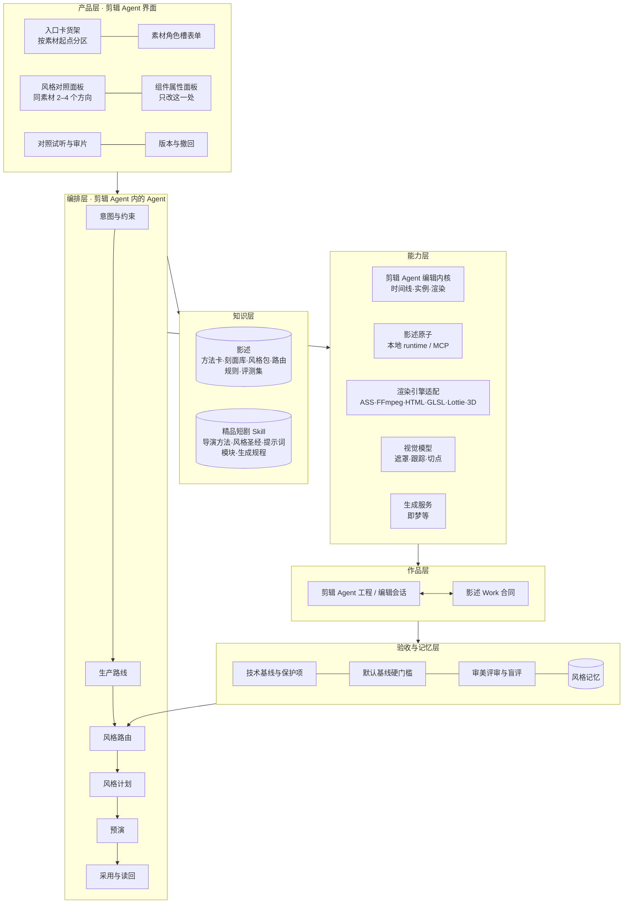

# 00 顶层设计：多风格能力怎样收敛到剪辑 Agent

**终点是一个产品：剪辑 Agent。** 用户在剪辑 Agent 里按手上的素材选入口，看到同一素材的几个风格方向，选一个或混合，Agent 在工程里生成可预演、可采用、可撤回的修改，用户可以只改一个字幕、一个组件实例或一个调色层。影述是这个产品的**剪辑知识与原子能力层**，精品短剧 Skill 是它的**生成导演层**；两个仓库分别写、分别验，但设计对象都按剪辑 Agent 的对象来定义，最终一一落进它的工程与界面。

## 一、整体分层

| 层 | 归属 | 影述在这一层提供什么 |
|---|---|---|
| 产品层 | 剪辑 Agent | 入口模板、风格对照的展示数据、组件的可编辑属性表、返工单位说明 |
| 编排层 | 剪辑 Agent 内的 Agent，加载 Skill | 场景路由（[router.md](../../registry/router.md)）、生产路线判定、风格路由（[05](05-style-routing.md)）、风格计划编译（[06](06-pack-assembly.md)） |
| 知识层 | 影述（剪辑）＋精品短剧 Skill（生成） | 580 张方法卡、[刻面库与 264 个风格包](03-scenario-style-catalog.md)、[126 个组件](04-motion-components.md)、路由信号与评测集 |
| 能力层 | 剪辑 Agent 内核为主，影述原子为可移植实现 | 原子操作与渲染引擎适配；宿主有等价能力时用宿主的（[能力交接合同](../../contracts/capability-handoff.md)） |
| 作品层 | 剪辑 Agent 工程为权威 | [Work 合同](../../contracts/work-contract.md) 定义候选、范围、保护、版本语义，映射到宿主编辑会话 |
| 验收与记忆层 | 两边共建 | [基线、评测集与优质样本](09-baseline-eval.md)，风格记忆 |

## 二、对象映射：影述对象 → 剪辑 Agent 对象 → 接口

研究库《真人口播与实拍单品任务卡》已为剪辑 Agent 定义 I0–I7 八组接口。多风格体系复用它们，并补五组（I8–I12）。

| 影述对象 | 剪辑 Agent 对象 | 接口 | 状态 |
|---|---|---|---|
| 素材画像 `material-profile/1` | 工程素材、词稿、播放实例、主体框 | I0 读取、I2 词稿锚点 | 复用，补信号字段 |
| 风格路由结果 `style-route-result/1` | 风格对照面板的数据 | **I10 多风格变体** | 新增 |
| 入口模板（卡片） | 首页卡片、表单、样片 | **I8 卡片与风格注册** | 新增 |
| 风格包 `style-pack/1` | 卡片绑定的风格预设 | I8 | 新增 |
| 设计系统 | 工程设计偏好（主题 token） | I8 | 新增 |
| 组件 | MG 资产（声明属性、模板版本） | I5 实例属性、**I9 组件渲染适配** | I5 复用，I9 新增 |
| 组件实例 | 时间线图层实例 | I5 | 复用 |
| 风格计划 `style-plan/1` | 编辑会话中的一组预演修改 | I1 编辑会话、I4 词级预演 | 复用 |
| 同点试听、对照 | 原版与候选成对试听 | I3 | 复用 |
| 主张—证据表 | 商品证据绑定 | I6、I7 | 复用 |
| 补镜请求、生成候选 | 生成任务、结果资产 | **I11 生成任务** | 新增，对接生成侧 |
| 基线、评测集、盲评记录 | 评测与回归工具 | **I12 评测 harness** | 新增 |

新增接口的最小行为：

| 接口 | 传入 → 返回 | 必验边界 |
|---|---|---|
| I8 卡片与风格注册 | 风格包、设计系统、组件集的 ID 与摘要 → 宿主内可选的风格预设与卡片；工程记住当前设计系统 | 切换设计系统只重渲染受影响实例，不改剪辑与字幕文字；未声明的属性不能被风格改动 |
| I9 组件渲染适配 | 组件模板、实例属性、tokens、时长 → 宿主可放置的图层（原生实例或带 alpha 的渲染件）与回执 | 同一属性在不同引擎渲染结果一致（属性等价测试）；宿主原生组件优先，渲染件作降级 |
| I10 多风格变体 | 同一基线修订与 2–4 个风格计划 → 各自独立的预演变体、对照页 | 变体互不污染；采用其一后其余失效；父版保护 |
| I11 生成任务 | 补镜或生成请求（参考角色、风格方向、可用标准、预算）→ 任务 ID、候选资产、费用 | 超时先查原任务；候选回到素材池评审后才进时间线；生成画面不作事实证据 |
| I12 评测 harness | 风格包版本、评测集、基线定义 → 技术检查、一致性检查、盲评任务与汇总 | 评测集与基线版本冻结；结果绑定包版本；不达门槛的包不得上架 |

## 三、收敛路径：从离线到内置

| 阶段 | 谁执行 | 影述交付 | 剪辑 Agent 接入 | 退出条件 |
|---|---|---|---|---|
| A · 离线验证 | 外部 Agent ＋ 影述本地 runtime | 风格包在本地出片、预览、评测；基线门槛跑通 | 无 | 首批包在评测集上过门槛（[09](09-baseline-eval.md)） |
| B · 外部接入 | 外部 Agent 通过 MCP 操作剪辑 Agent | 风格计划翻译成剪辑 Agent 的编辑会话修改；组件以渲染件或宿主实例放入 | I0–I5 复用，I9/I10 首版 | 同一工程内多风格预演、采用、撤回、冷开、导出全部读回一致 |
| C · 应用内置 | 剪辑 Agent 内置 Agent | 入口模板、风格包、组件库作为内置资源 | I8–I12 正式版 | 首页卡片、风格对照面板、属性面板可用；用户只改一处的局部修改例通过 |

研究库的建设顺序是阶段二外部 Agent 操作桌面、阶段三应用内完成、阶段五商品场景。本路径与之对齐：A 对应其离线旁路，B 对应阶段二，C 对应阶段三及以后。

## 四、设计原则

1. **素材起点优先。** 先定剪辑 / 生成 / 混合 / 方案路线，再在路线内比较风格；入口说明返工单位。
2. **刻面正交。** 方法、节奏、设计系统、组件、字幕、影调、声音、生成处理各管一件事，只通过风格包的绑定规则发生关系。
3. **决策分配显式。** 每个决策槽标 `locked / runtime / user`；换风格时界面能说出什么会变。
4. **皮肤复用，机制立项。** 换设计系统就能得到的风格不新增能力；需要遮罩、跟踪、转绘、生成的风格是机制包，单独验收。
5. **信号驱动。** 组件出现在哪里由带词级时间的内容信号决定，有密度、间隔、优先级和人脸避让。
6. **多方向。** 路由给稳妥、特色、反差三个方向，各附证据与代价。
7. **真实素材预览。** 先文字方案、风格帧、样段，再全片渲染或付费生成。
8. **事实与保护在上。** 风格不能改动受保护的词、数值单位、否定、引用归属和证据镜头。
9. **效果优先选引擎。** 同一个组件可以有多个渲染实现，按效果上限、可编辑性、确定性和成本选；宿主原生可编辑优先，效果不够再用渲染件。
10. **验证分级，基线为门。** 包按 `authored → compiled → previewed → limited-trial → validated` 升级；升级到 `limited-trial` 以上必须在盲评中胜过定义好的默认基线。

## 五、八层运行模型

| 层 | 职责 | 主要对象 |
|---|---|---|
| L0 意图与约束 | 交付模式、观众任务、平台、品牌、系列、禁止项、预算；风格说法记成 StyleIntent | `TaskSpec`、`style-intent` |
| L1 素材画像 | 带证据的内容信号、画面与声音特征、上下文 | `material-profile/1` |
| L2 生产路线 | EDIT / GENERATE / HYBRID / PLAN 与返工单位 | `production-route` |
| L3 风格路由 | 资格过滤 → 适配打分 → 多样性选取 → 解释 | `style-route-result/1` |
| L4 风格包 | 刻面组合、决策槽、绑定规则、能力需求、签名与克制、检查项 | `style-pack/1` |
| L5 编译 | 逐项决定与执行图，编译为 Work 候选 | `style-plan/1`、`work-candidate/1` |
| L6 原子能力 | 宿主中立的类型化操作与渲染引擎 | 能力图 |
| L7 验收与记忆 | 技术、保护、一致性、审美、基线门；采用后入风格记忆 | 检查报告、`style-memory` |

一次任务的生命周期：

| 阶段 | 产物 | 放行条件 | 可在此交付 |
|---|---|---|---|
| 解析意图 | TaskSpec＋StyleIntent | 交付模式、平台、禁止项已记录 | 否 |
| 画像 | MaterialProfile | 关键信号带证据 | 素材分析 |
| 路由 | 三个方向＋解释 | 每个方向至少 2 条素材证据和 1 条代价 | 风格方案对照 |
| 预览 | 文字方案 / 风格帧 / 样段 | 在真实素材上选定 | 风格帧、样段 |
| 编译 | StylePlan＋执行图 | 能力可用或已声明降级 | 可编辑计划 |
| 执行 | Work 候选＋渲染 | 技术检查通过，保护项未触碰 | 候选成片 |
| 验收 | 一致性与审美报告 | 达到包声明的检查项 | 成片 |
| 采用与记忆 | 新版本＋风格记忆 | 用户采纳 | — |
| 修订 | 局部修改 StylePlan | 只改授权对象 | 修订版 |

## 六、与生成侧的关系

精品短剧 Skill 负责“拍成什么样”：剧本画像、风格方向、风格圣经、镜头与提示词、生成与选片。影述负责“剪成什么样并改得动”：剪辑方法、包装风格、后期统一、多版本与局部修订。两边通过三份文件交换（交接后期、补镜请求、生成回收），影述一侧的接口见 [11 对外接口](11-interfaces.md)。生成侧的方案在其仓库内单独维护。
