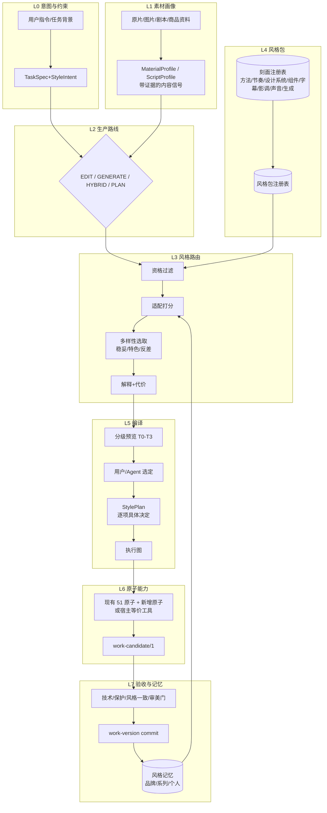
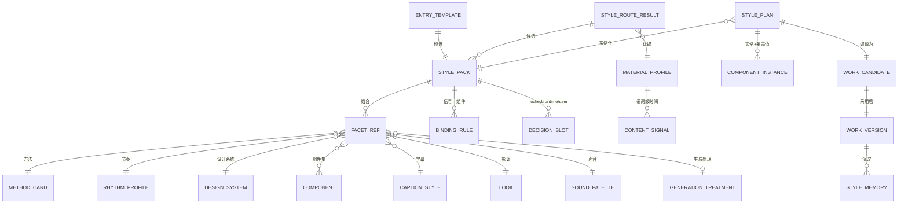

# 02 顶层架构：八层风格操作模型

## 一、总体结构

| 层 | 职责 | 主要对象 | 与现有资产的关系 |
|---|---|---|---|
| L0 意图与约束 | 解析交付模式、观众任务、平台规格、品牌、系列、禁止项、预算；把“要什么风格”的说法记成 StyleIntent | `TaskSpec`（扩展）、`style-intent` | 沿用 [router.md](../../registry/router.md) 的 TaskSpec 记录规则：原话 / 上下文 / 推断分开 |
| L1 素材画像 | 把素材变成带证据的特征：内容信号（数值、步骤、引语、比较、转折、情绪峰）、画面（人脸位置、景别、背景复杂度、色彩）、声音（语速、音乐、噪声）、上下文 | `material-profile/1`、`script-profile/1` | 复用 media-inspect、color-profile-scan、media-signal-scan、transcript-import、speech-transcribe-local；新增信号抽取 |
| L2 生产路线 | 按素材起点决定剪辑、生成、混合或只出方案；声明交付对象与返工单位 | `production-route` | ChatCut 的 agent-request / 视频生成 / 图片生成 / 指南四分法 |
| L3 风格路由 | 在路线内挑选风格包：资格过滤 → 适配打分 → 多样性选取 → 解释 | `style-route-result/1` | 取代 creation-recommendation 只比字号的做法；router.md 仍选工作流 |
| L4 风格包 | 组合刻面，声明决策槽、绑定规则、能力需求、可调旋钮、检查项与返工单位 | `style-pack/1` 与 8 类刻面 | 580 张方法卡成为“方法刻面”；调色/质感配方成为“影调刻面” |
| L5 编译 | 把包＋画像＋当前作品编译成逐项决定（哪个词触发哪个组件、哪段用哪种字幕、影调和声音事件），再展开为执行图 | `style-plan/1`、执行图 | 输出仍是 `work-candidate/1`，不新建第二套作品状态 |
| L6 原子能力 | 宿主中立的类型化操作；本库本地实现或编辑器等价工具 | 能力图（带输入输出类型） | 严格遵守 [能力交接合同](../../contracts/capability-handoff.md) |
| L7 验收与记忆 | 技术 QC、保护项、风格一致性、审美门；采用后写入风格记忆 | `style-conformance`、`taste-review`、`style-memory` | 沿用 PASSED / DEGRADED / BLOCKED 与 `not-run`、`not-verifiable` 口径 |

## 二、九条设计原则

1. **素材起点优先（Material-first）。** L2 决定路线后，L3 只在可行路线内比较风格。同一句“做成种草风”，有真人实拍时走剪辑包，只有商品图时走生成包，两者在入口就提示返工单位不同。
2. **刻面正交（Orthogonal facets）。** 每个刻面只管一件事：方法管“选什么、按什么顺序”，节奏管“多快、在哪停”，设计系统管“长什么样”，组件管“画出可改的实例”，字幕管“字怎么出现”，影调管“像素颜色与质感”，声音管“底声、音乐、音效与避让”，生成处理管“镜头怎样被生成”。刻面之间只通过风格包的绑定规则发生关系。
3. **决策分配显式（Decision allocation）。** 风格包的每个决策槽标 `locked / runtime / user`。用户换包时，界面能说清“这些会变、这些不变”。
4. **复用分级（Skin vs Mechanism）。** 包可以 `extends` 另一个包，只覆写设计系统和少量参数即成皮肤包；需要新原子才能实现的是机制包，单独立项、单独验收。
5. **信号驱动（Signal-driven placement）。** 组件出现在哪里由内容信号的词级时间决定，不由固定间隔或随机决定；每条规则有密度上限、最小间隔、优先级和人脸避让。
6. **多方向而非单点（Diverse candidates）。** 路由默认给三个方向：稳妥（最高适配）、特色（签名手法最强且适配过线）、反差（与前两者距离最大且有理由）。
7. **真实素材预览（Preview on real material）。** 方向对照在用户素材上做；昂贵步骤（全片渲染、付费生成）之前必须经过低成本预览门。
8. **事实与保护在上（Facts over style）。** 风格包不能修改受保护的词、数值单位、否定、引用归属、证据镜头；绑定规则只能读取保护项、不能改写。冲突时风格让位并记 DEGRADED。
9. **验证分级（Validation tiers）。** 包与刻面都有 `authored → compiled → previewed → limited-trial → validated` 状态；货架、推荐与报告按状态区分，不以条目数代表能力。

## 三、核心对象关系

- **入口模板（entry-template）** 是面向用户的“卡”：样片、素材角色槽（如“出镜人物”“商品与包装”“动作参考”）、交付物与返工单位、预选的风格包。它对应 ChatCut 的 Skill 卡，但不复制其内容。
- **风格包（style-pack）** 是可执行的风格主题；**刻面（facet）** 是可复用零件；**绑定规则（binding-rule）** 是把内容信号接到组件的胶水。
- **StylePlan** 是“本次素材 × 本风格包”的具体决定清单，审阅、比较、局部修改都针对它；它编译成现有 Work 候选，所以所有版本、范围、恢复机制继续有效。

## 四、风格在一次任务中的生命周期

| 阶段 | 产物 | 放行条件 | 可停在这里交付吗 |
|---|---|---|---|
| 1 解析意图 | TaskSpec＋StyleIntent | 交付模式、平台、禁止项已记录；风格说法标来源 | 不可（内部） |
| 2 画像 | MaterialProfile | 关键信号有证据（词 ID、源时间、帧号） | 可交“素材分析” |
| 3 路由 | 3 个方向＋解释 | 每个方向至少 2 条来自素材的证据和 1 条代价 | 可交“风格方案对照” |
| 4 预览 | T0 文字方案 / T1 风格帧 / T2 样段 | 用户或评审在真实素材上选定或要求换向 | 可交“风格帧/样段” |
| 5 编译 | StylePlan＋执行图 | 能力全部可用或已声明降级 | 可交“可编辑计划” |
| 6 执行 | work-candidate＋渲染 | 技术 QC 通过，保护项未被触碰 | 可交“候选成片” |
| 7 验收 | 风格一致性＋审美门报告 | 达到包声明的检查项；盲评结果单列 | 可交“成片” |
| 8 采用与记忆 | 新 Work 版本＋风格记忆条目 | 用户采纳；记忆条目绑定版本与证据 | — |
| 9 修订 | 局部 StylePlan 修改 | 只改授权对象，其余保持 | 可交“修订版” |

## 五、两仓在架构中的位置

- **影述（剪辑侧）** 实现 L1 的媒体画像、L3–L7 的剪辑路线与混合路线后期部分，拥有共享刻面词汇（设计系统、字幕、影调、声音、节奏）与 Work 作品身份。
- **精品短剧 Skill（生成侧）** 实现剧本画像、生成路线的风格路由、风格圣经与镜头提示词编译、生成与选片；它的风格圣经中“后期刻面”直接引用影述的影调、字幕、声音、节奏对象。
- 交接协议与三条联动链路见 [07 两仓互补](07-cross-repo.md)。
