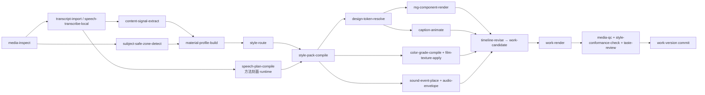

# 04 风格包：刻面、决策槽与原子能力装配

## 一、八类刻面

刻面是可复用、可单独版本化和验收的风格零件。风格包只引用刻面 ID 与版本，不复制内容。

| 刻面 | 管什么 | 关键字段 | 来源 |
|---|---|---|---|
| `method` 剪辑方法 | 选什么、删什么、按什么顺序、保护什么 | 沿用现有卡片字段；新增可选结构化 `fit` / `anti` 谓词与 `selection_rules` | 现有 580 张[风格卡](../../styles/speech/index.md)，不改名、不改路径 |
| `rhythm` 节奏 | 多快、在哪停、开头多久进入 | 目标时长比、切点密度曲线、停顿保留阈值、开头窗口、B-roll 间隔、最长单镜、是否对齐节拍 | 新增；从 `styles/pacing` 卡提炼 |
| `design-system` 设计系统 | 长什么样 | 颜色角色、字体与字阶、中文排版规则、各画幅版位、运动曲线、质感、图标、可做与禁做 | 新增；首批按 ChatCut 的 7 类视觉语言各建 1–2 套原创设计系统 |
| `component` 组件 | 画出可局部修改的图形实例 | 模板引擎、属性表（类型/范围/枚举/默认/可编辑）、时间模型、版位约束、渲染输出 | 新增；扩展 `visual-layer-render` |
| `caption-style` 字幕 | 字怎样出现 | 分组方式（整句/短语/逐词）、强调规则、字号随画幅、字幕带、动画、每行最多字数、断行规则 | 新增；落在 `caption-burn` 与字幕样式上 |
| `look` 影调 | 像素颜色与质感 | 调色层 ops、LUT 与强度、胶片颗粒/光晕/暗角、保护色相 | 包装现有 `color-grade-compile`、`film-texture-apply`、`color-reference-fit` |
| `sound` 声音 | 底声、音乐、音效与避让 | 音乐类型/速度/能量与授权、音效集与触发、避让深度与起落、环境声策略、响度目标 | 新增；落在 `audio-mix`、`audio-envelope` |
| `generation` 生成处理 | 生成镜头的视觉处理与参考角色 | 处理类型、参考角色槽、提示词模块、负面模块、模型能力需求 | 与短剧仓库共用，见 [07](07-cross-repo.md) |

刻面 Schema 草案见 [facets.schema.json](schemas/facets.schema.json)，样例：[技术看板设计系统](examples/design-system.tech-redblack.json)、[规格表组件](examples/component.spec-table.json)。

### 设计系统的最小内容

一个设计系统必须能回答“这一帧该用什么颜色、什么字、放在哪、怎么动”：

- **颜色角色**：`bg`、`surface`、`ink`、`ink-muted`、`accent`、`highlight`、`positive`、`negative`；每个角色给 sRGB 值与使用比例上限（如 `accent ≤ 10%` 画面）。
- **字体与字阶**：中文与西文字体（按文件哈希绑定，沿用 `caption_font_binding`），字阶比例，标题/数值/标签/正文四级的最小可读字号（按 1080 短边）。
- **中文排版**：每行最多字数、避头尾、数字与单位不拆行、全角半角规则、竖排是否允许。
- **版位**：按 16:9 / 9:16 / 1:1 分别定义 `beside-subject-left/right`、`lower-third`、`upper-band`、`fullscreen`、`corner-tag` 的矩形与安全边距。
- **运动**：入场、停留、退场的时长与缓动曲线；允许的运动类型（滑入、擦除、逐字、描边）；最长持续。
- **质感**：纸纹、颗粒、描边、阴影的开关与强度。
- **禁做**：例如“`highlight` 只给正在讲的那一个值”“不把人物脸放进 `fullscreen` 版位”。

### 组件的最小内容

组件是一个参数化模板加一张属性表。属性表决定了“能局部改到哪一层”：

```json
"props": {
  "rows":        {"type": "array", "editable": true, "items": {"label": "string", "value": "string", "unit": "string"}},
  "active_row":  {"type": "integer", "editable": true, "min": 0},
  "title":       {"type": "string", "editable": true, "max_chars": 12},
  "side":        {"type": "enum", "values": ["left", "right"], "editable": true, "default": "right"}
}
```

时间模型统一为 `anchor`（绑定的词区间）＋ `lead_ms`（提前出现）＋ `min_hold_ms` ＋ `exit`（`on-topic-change` / `fixed` / `next-trigger`）。实例写入 Work 时只保存模板 ID、模板版本与覆盖值；改第二处只改该实例的覆盖值。

## 二、风格包结构

完整 Schema 见 [style-pack.schema.json](schemas/style-pack.schema.json)。下面是“红黑参数看板”包的骨架（完整样例：[pack.speech-spec-redline.json](examples/pack.speech-spec-redline.json)）：

```yaml
id: speech-spec-redline
extends: speech-packaging-base          # 继承共用口播流水线
cost_tier: skin                          # 只换设计系统与组件集
routes: [EDIT]
workflow: raven-speech-edit
facets:
  method: method/speech/evidence-led@0.1.0
  rhythm: rhythm/tight-explainer@0.1.0
  design_system: ds/tech-redblack@0.1.0
  components: [cmp/spec-table@0.1.0, cmp/value-callout@0.1.0]
  caption_style: cap/keyword-accent@0.1.0
  look: look/neutral-crisp@0.1.0
  sound: snd/minimal-ticks@0.1.0
decision_slots:
  - {id: design_system, mode: locked}
  - {id: which_values_to_show, mode: runtime, owner: agent-semantic}
  - {id: table_side, mode: runtime, owner: deterministic, rule: "人脸对侧"}
  - {id: music, mode: user, default: none}
binding_rules:
  - id: spec-row
    on: {signal: spec_pair}
    do: {component: cmp/spec-table, props: {active_row: "$signal.index", rows: "$group.spec_pairs"}}
    timing: {anchor: value_words, lead_ms: 120, min_hold_ms: 1800, exit: on-topic-change}
    placement: {prefer: [beside-subject-opposite], avoid: [face]}
    density: {max_per_min: 4, min_gap_ms: 2500}
    priority: 80
    fallback: caption-emphasis
signature:
  device: "只点亮正在讲的那一行，其余行保持暗灰"
  strength: 0.7
restraint:
  - "观点句不加图形，交给字幕强调"
  - "同一时刻画面最多一个图形组件"
cliche_blocklist: [every-line-popup, random-sfx, emoji-sprinkle]
checks: [value-word-sync, face-occlusion, density-budget, unit-integrity]
knobs:
  intensity: {range: [0, 1], default: 0.6, maps: {density.max_per_min: [2, 6], motion.amplitude: [0.3, 1.0]}}
editability:
  rework_units: [cut, caption-line, component-instance, grade-layer, audio-track]
```

### 决策槽：锁定、运行时、问用户

| 典型决策 | 口播包装包 | 商品实拍包 | 生成类包 |
|---|---|---|---|
| 设计系统、组件集、字幕样式 | locked | locked | locked |
| 剪辑方法（保真 / 紧凑 / 证据） | locked | locked | 不适用 |
| 删哪些词、选哪一遍 | runtime · agent-semantic | runtime | 不适用 |
| 哪个信号触发组件 | runtime · 绑定规则 | runtime · 主张证据表 | 不适用 |
| 版位左右 | runtime · deterministic（人脸对侧） | runtime | locked（构图） |
| 参考图角色 | 不适用 | user（明确哪张是商品） | locked（槽定义）＋ user（上传） |
| 音乐 | user | user | locked 或 user |
| 时长目标 | user | user | user（5/10/15 秒） |
| 价格与促销处理 | 不适用 | user | user |

这张表就是给用户看的“换风格会变什么”：换包只改 locked 列；runtime 列按新包规则重算；user 列保持用户已给的答案。

### 绑定规则：把内容信号接到组件

每条规则由七部分组成：

| 部分 | 说明 | 例子 |
|---|---|---|
| `on` 触发 | 画像中的信号类型及条件 | `spec_pair`；`quote where length ≤ 24 字`；`turn`（转折）；`chapter_boundary`；`emotion_peak where arousal ≥ 0.7` |
| `do` 动作 | 组件及属性映射，`$signal.*` 引用信号字段 | 规格表点亮第 n 行；引语大字显示原句 |
| `timing` 时机 | 锚点、提前量、最短停留、退出条件 | 数值词前 120 ms 出现，至少 1.8 秒，话题变化时退出 |
| `placement` 版位 | 优先版位与避让对象 | 人脸对侧；避开字幕带 |
| `density` 密度 | 每分钟上限、最小间隔 | 每分钟 ≤ 4 次，间隔 ≥ 2.5 秒 |
| `priority` 优先级 | 冲突时谁让位 | 规格表 80 ＞ 关键词强调 40 |
| `fallback` 降级 | 放不下或能力缺失时怎么办 | 退为字幕强调；或跳过并记录 |

规则只能读取保护项，不能改写台词、时间或证据映射。

## 三、继承、皮肤包与机制包

- **基础包**（如 `speech-packaging-base`）定义共用流水线：转写 → 清理 → 语义选择 → 词级编译 → 信号重映射 → 组件编排 → 字幕 → 影调 → 声音 → 渲染 → 检查。它不指定视觉。
- **皮肤包**只允许覆写：`design_system`、`caption_style`、`look`、`sound`、组件集中的“同类替换”（同一属性表的不同模板）、`knobs` 默认值、签名与克制文案。皮肤包继承基础包的验收证据中“流水线正确性”部分，但视觉与审美验收必须重做。对应 ChatCut 11 张口播包装中的 8 张。
- **机制包**新增基础包没有的能力需求（主体分割、物体跟踪、转绘、多层合成），或新增信号类型。它必须单独通过能力验收与风格验收。对应另外 3 张。
- **派生上限**：同一基础包下的皮肤包，两两相似度（定义见 [03 章 §六](03-style-routing.md)，连续轴距离与共用刻面比例的加权）须低于 0.85，否则视为同义改名，不能计为新风格。只换设计系统而方法、字幕、声音都相同的两个皮肤，共用比例已达 0.75，连续轴必须拉开足够距离才能过线。这延续了现有风格索引“同义改名、换字幕颜色或画幅不算新风格”的规定。

## 四、编译：从风格包到执行图

`style-pack-compile` 的步骤（输入：风格包、MaterialProfile、当前 Work 与范围授权）：

1. **解析刻面**：取各刻面的版本与摘要；设计系统叠加品牌覆写与目标画幅，得到解析后的 tokens。
2. **执行方法**：调用场景工作流按方法刻面做语义选择，产出词级剪辑计划（现有 `speech-plan-compile`）。这是 runtime 槽，Agent 判断，绑定保护项。
3. **信号重映射**：把画像中的信号从源时间映射到成片时间；被删除的词携带的信号作废，跨切点的信号拆分或作废。
4. **规则匹配**：逐条绑定规则匹配信号，得到候选事件 `(规则, 信号, 时间窗, 属性)`。
5. **调度**：按优先级降序、时间升序做区间调度；违反密度、最小间隔或与保护项冲突的事件让位到 `fallback`。
6. **版位求解**：对每个事件在设计系统的候选版位中选一个不与人脸/主体框、字幕带、更高优先级组件相交的矩形；都不行则降级。
7. **字幕计划**：按字幕刻面分组，强调词来自 `emphasis_word` 信号；字幕带与组件区互斥检查，复用 `style-recipe` 的 `layout_constraints` 覆盖检查。
8. **影调与声音**：生成调色层（`color-grade-compile`）、质感（`film-texture-apply`）、音乐床与音效事件（触发自规则）、避让包络（`audio-envelope`）。
9. **输出**：`style-plan/1`（逐项决定，见 [style-plan.schema.json](schemas/style-plan.schema.json)）与执行图；执行后得到 `work-candidate/1`，进入预览与审阅。

### 能力图：类型化的原子操作

编译器按“产物类型”连接原子，从而知道一个包需要哪些能力、缺哪个会影响哪一步：

| 产物类型 | 产出它的原子（现有 / 新增） | 消费它的原子 |
|---|---|---|
| `MediaRef` | `media-inspect` | 全部 |
| `Transcript` | `transcript-import`、`speech-transcribe-local` | `content-signal-extract`、`speech-plan-compile` |
| `MaterialProfile` | 新增 `material-profile-build`（聚合） | `style-route`、`style-pack-compile` |
| `SignalSet` | 新增 `content-signal-extract`、`subject-safe-zone-detect`、`beat-detect` | `style-pack-compile` |
| `WordPlan` | `speech-plan-compile` | `timeline-render`、`work-version` |
| `ResolvedTokens` | 新增 `design-token-resolve` | `mg-component-render`、`caption-animate` |
| `ComponentLayer` | 新增 `mg-component-render`；降级为 `visual-layer-render` 静态叠层 | `work-render` |
| `CaptionTrack` | `caption-map`、新增 `caption-animate` | `caption-burn`、`work-render` |
| `GradeLayer` | `color-grade-compile`、`color-reference-fit`、`film-texture-apply` | `work-render`、`color-consistency-check` |
| `AudioMix` | `audio-mix`、`audio-envelope`、新增 `sound-event-place` | `work-render` |
| `WorkCandidate` | `timeline-revise`、`style-recipe-compile`（扩展） | `work-render`、`work-version` |
| `Render` | `work-render`、`work-batch-render` | `media-qc`、新增 `style-conformance-check`、`taste-review` |

口播包装基础包的执行图：



### 降级矩阵

| 缺失能力 | 受影响刻面 | 降级方式 | 报告口径 |
|---|---|---|---|
| `mg-component-render` | 组件 | 用 `visual-layer-render` 渲染静态 PNG 叠层，无运动 | DEGRADED：动效未实现，属性仍可改 |
| `subject-safe-zone-detect` | 版位 | 调用方声明保护区；无声明则仅用全屏切出版位 | DEGRADED：遮挡未自动避让 |
| `caption-animate` | 字幕 | 静态 `caption-burn`，强调改颜色 | DEGRADED：逐词动画未实现 |
| 音乐授权库 | 声音 | 不加音乐，只保留音效或无 | DEGRADED：音乐缺省 |
| 主体分割 / 跟踪 / 转绘 | 机制包 | 包 `ineligible` | 推荐其他方向 |

## 五、返工单位与可编辑性

入口和交付报告都要说清每类对象改起来多贵：

| 对象 | 怎样局部改 | 不影响什么 |
|---|---|---|
| 切点 | 改 WordPlan 中的词选择，重编译该段 | 其他段、组件实例（随时间重映射） |
| 字幕行 | 改该 cue 的文字或样式覆盖 | 原声、其他 cue |
| 组件实例 | 改该实例的覆盖值（如第二张规格卡的 500 g → 0.5 kg） | 第一张实例、模板默认值、原声、字幕 |
| 设计系统 | 换包或覆写 token，全片组件重渲染 | 剪辑、字幕文字、声音 |
| 调色层 | 改该层参数或强度 | 其他层、字幕 |
| 音轨 | 改增益或包络 | 画面 |
| 生成镜头 | 重新生成该镜头（新候选） | 其他镜头；但下游依赖该镜末状态的镜头需复审 |

## 六、存放与生命周期

建议目录（验证通过前不加入 `contracts/package-members.json`）：

```
packs/<domain>/<pack-id>.json          # 风格包
facets/rhythm/<id>.json
facets/design-systems/<id>.json
facets/components/<id>/component.json  # 属性表与时间模型
facets/components/<id>/template.html   # 或 .ass / ffmpeg 滤镜脚本
facets/caption-styles/<id>.json
facets/looks/<id>.json                 # 引用现有调色/质感配方
facets/sounds/<id>.json
```

状态沿用库内口径并细化：`authored`（写好）→ `compiled`（编译器在合成样例上通过）→ `previewed`（在 1 条真实素材上出过 T1/T2）→ `limited-trial`（≥3 条真实素材，有盲评记录）→ `validated`（≥10 条，盲评胜过默认基线，返工指标达标）。`scripts/verify_library.py` 扩展一项结构检查：包引用的刻面存在且版本摘要一致、皮肤包只覆写允许字段、同基础包下皮肤包相似度 < 0.85。设计阶段可先用本目录的 [validate_examples.py](validate_examples.py) 检查样例。
