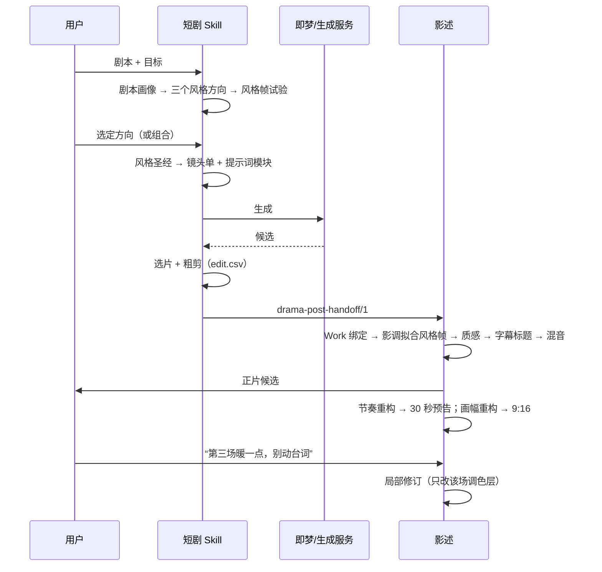

# 07 两仓互补：生成侧与剪辑侧的边界与交接

## 一、职责划分

| 能力 | 精品短剧 Skill（生成侧） | 影述（剪辑侧） |
|---|---|---|
| 剧本画像、风格方向、风格圣经 | **主责** | 消费圣经中的后期刻面 |
| 剧情领域合同（人物、命题、事件、场次、Beat、镜头） | 按 W17 [最小合同](../../contracts/drama/01-最小合同.md) 字段输出 | **主责**：校验、上下文装配、修改影响、作品绑定 |
| 镜头单、提示词模块、参考角色槽、即梦执行、候选与选片 | **主责** | 不重复实现；只读候选回执 |
| 粗剪（同场先搭对白与证据） | **主责**（edit.csv） | 导入为 Work |
| 统一影调、质感、字幕与标题、混音、多版本、局部修订、预告与竖屏拆条 | 在圣经中声明意图 | **主责**：现有调色、质感、字幕、音频、版本、批量渲染原子 |
| 剪辑中发现缺镜 | 接收补镜请求，按圣经出镜头单并生成 | **发起**补镜请求，回收候选、评审、采用 |
| 商品与口播里的生成插入镜 | 提供生成拍法与参考角色规程 | 混合路线的发起与剪辑方 |

一句话：**生成侧决定“拍成什么样”，剪辑侧保证“成片始终是那个样，并且改得动”。** 影述 W17 管作品身份与修订，精品短剧 Skill 管导演与生成，二者通过三份交接文件连接，不互相复制状态。

## 二、共享风格词汇

| 刻面 | 定义方 | 另一方怎样用 |
|---|---|---|
| `look` 影调 | 影述（[facets.schema.json](schemas/facets.schema.json) `look`） | 圣经写“主光从画左、湿石窄亮、整体低饱和暖灰”，同时给出风格帧；影述用 `color-reference-fit` 从风格帧拟合可编辑调色层，`color-consistency-check` 守住跨镜一致 |
| `caption-style` 字幕与标题 | 影述 | 圣经声明题签与字幕调性（书法题签、竖排、极简衬线）；影述落成字体文件、字号、版位 |
| `sound` 声音 | 影述 | 圣经声明底声、主题动机、静默点；影述做摆放、避让与响度 |
| `rhythm` 节奏 | 影述 | 圣经声明剪辑节奏（留白慢剪、反应先行、声桥）；影述做预告、竖屏等改节奏版本时继承 |
| `generation` 生成处理 | 短剧 Skill | 影述混合路线补镜时引用，不自行实现提示词 |
| `design-system` 设计系统 | 影述 | 片头字卡、人物条、集数标题按圣经选择或派生 |

## 三、三份交接文件

### 1. `drama-post-handoff/1`：生成侧 → 剪辑侧

Schema 见 [post-handoff.schema.json](schemas/post-handoff.schema.json)。核心内容：

| 字段 | 内容 |
|---|---|
| `project / episode / revision` | 项目、集数、交接修订号 |
| `drama_content_ref` | W17 `drama-content/0.1` 的路径与 SHA-256（可选；有则 W17 校验） |
| `bible_ref` | 风格圣经路径、版本、SHA-256，选定的方向 ID |
| `takes[]` | 入选候选：资产 ID、生成任务 ID、文件路径与 SHA-256、帧率、可用源区间、拒绝原因摘要 |
| `timeline[]` | 粗剪：每行镜头 ID、候选资产、源入出帧、时间线入出帧、选择理由（来自 `edit.csv`） |
| `audio_stems[]` | 对白、环境、拟音、音乐各轨及说话人绑定 |
| `captions[]` | 字幕 cue：说话人、文本、时间；是否允许烧录 |
| `protections[]` | 台词原文、证据镜头、揭示顺序、声音先入点；后期不得改动 |
| `post_facets` | `look`（ID 或参数 ＋ 风格帧路径）、`texture`、`caption_style`、`title_design`、`sound`、`rhythm` |
| `deliverables[]` | 例：16:9 正片、9:16 竖屏、30 秒预告、无字幕母版 |
| `known_issues[]` | 已知缺陷与时间码（审片单） |

影述侧动作：校验文件与字节 → 用 W17 绑定 `drama-content` → 生成 Work（clips、audio、captions、protections）→ 应用后期刻面产生候选 → 预览 → 采用。

### 2. `shot-request/1`：剪辑侧 → 生成侧（补镜）

Schema 见 [shot-request.schema.json](schemas/shot-request.schema.json)。核心内容：作品 ID 与版本、插入位置与所需时长、**观众此刻要新知道什么**、前后镜末态/首态的帧引用、圣经与方向 ID、参考角色（身份、场景、动作、道具、风格）、约束（不得引入新事实、不得改变人物所知）、可用标准（什么样的候选算可用）、预算上限。

生成侧动作：按镜头单格式写成一镜，选模式（多模态 / 硬首尾），生成候选，按候选表登记，交回 `generation-return`。

### 3. `generation-return/1`：生成侧 → 剪辑侧（候选回收）

每个候选的任务 ID、资产与 SHA-256、实付、实测规格、可用区间与缺陷时码、Agent 初选与理由。影述把它作为 Work 的候选素材，走 `timeline-revise` 和局部采用；任务超时先查原任务，`UNKNOWN` 不等于失败（沿用现有生成规则）。

## 四、三条联动链路

### 链路一：剧本 → 多风格方向 → 成片 → 多版本

**同一套生成素材，可以再风格化一次。** 生成侧的风格方向决定像素；剪辑侧可以在不重新生成的前提下，用不同后期风格包做出正片、预告、竖屏解说等版本（例如预告用“声音先入＋黑场＋字卡”节奏包，竖屏用“人物条＋大字台词”包装包）。两次风格化的边界：剪辑侧只能改影调、质感、字幕、节奏、声音与包装，不能改变镜头内表演和画风。

### 链路二：剪辑中补镜

1. 影述在粗剪中发现“交石后缺一个登记吏停笔的反应镜”，生成 `shot-request/1`，附前镜末帧与后镜首帧。
2. 短剧 Skill 按圣经的“听者反应”镜头语法与提示词模块写一镜，提交生成。
3. 候选经 `generation-return/1` 回到影述，进入原作品候选池；评审后局部采用，其余时间线不动。
4. 如果补镜改变了下一镜依赖的状态，W17 修改影响把下游镜头标为待复审。

### 链路三：商品与口播的混合路线

影述的商品或口播包需要一个“手持演示”插入镜而原片没有时，以 `HYBRID` 路线发起补镜，生成侧按商品参考角色规程（商品与包装、出镜人物、动作参考）生成。回收后该镜在主张—证据表中标为“演绎画面”，不能作为真实功效的证明镜头。

## 五、Schema 的归属与版本

- 共享刻面与三份交接文件的 Schema 以影述 `docs/multi-style/schemas/` 为唯一来源（验证通过后迁入 `contracts/`）；短剧仓库引用固定提交的 URL，不复制。
- 生成处理刻面（`generation`）由短剧仓库维护内容，结构定义在共享 Schema 中，便于影述在混合路线中读取。
- 任何一方改 Schema 必须升主版本（如 `drama-post-handoff/2`），旧版本至少保留一个迭代周期的读取兼容。

## 六、落地顺序

1. 先定 `drama-post-handoff/1`，用《青锋有痕》登记桌 15 秒试拍的已选候选与剪辑表做第一次导入，验证 Work 绑定与影调拟合（不需要新生成）。
2. 再定 `shot-request/1` 与 `generation-return/1`，用一次真实补镜跑通往返。
3. 最后把短剧仓库的风格圣经后期刻面与影述的影调、字幕、声音刻面字段对齐，并在 W17 中增加 `bible_ref` 的可选绑定。
